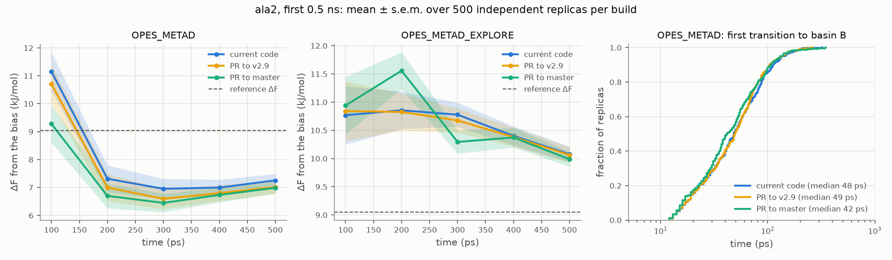
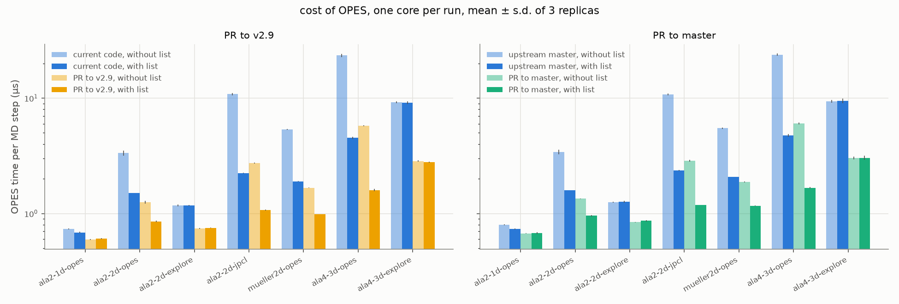

# OPES: the two proposed PRs, tested against the current code

This note compares the current OPES code with the two pull requests prepared from the work in
[kernel-cutoff.md](kernel-cutoff.md), [kernel-merging.md](kernel-merging.md), [nlist.md](nlist.md)
and [opes-review.md](opes-review.md). One PR goes to v2.9, the oldest maintained branch, on top
of [plumed/plumed2#1463](https://github.com/plumed/plumed2/pull/1463). The other goes to master, on
top of the first.

**Update, 2026-10-12: #1463 is merged into v2.9** (`b43b7c4`), with its change of the derivative:
the forces are now the gradient of the energy-shifted kernels. The two branches were rebased on it
(section 1). The tests of sections 3–5 were run before, on builds without that change: what they
mean now is in section 1, "After #1463".

**Summary.**
- **The PR to v2.9** contains:
  - the bugs M1–M4 and E1–E5;
  - an exact neighbor list as the only behaviour;
  - a note on static biases (`UPDATE_UNTIL=0`);
  - `FES_from_State.py` derivatives as in PLUMED after #1463;
  - faster kernel sums, as the last commit.

  The kernels are those of v2.9 with #1463. **The PR to master** adds force-shifted kernels and
  turns the neighbor list on by default (`NLIST_OFF` to switch it off).
- **Regtests pass** in serial, MPI and MPI with 4 threads builds. Every changed reference is
  explained (section 2). The new regtests fail with the current code.
- **The PR to v2.9 does not change the sampling.** 0 of 128 tests are marked in the quick tier
  (all systems of the OPES and Explore papers), and 0 of 32 in the early transient of ala2 with
  500 replicas.
- **The PR to master changes only the early transient.** It shows the effect of the force-shifted
  kernels already measured in [kernel-cutoff.md](kernel-cutoff.md):
  - the first transition comes earlier (median 42 vs 48 ps, p = 0.05);
  - basin B is transiently over-filled a little more (p = 0.005);
  - nothing changes after ~2 ns or with OPES_METAD_EXPLORE.

  The one test marked in the quick tier (1 of 128) disappears with 100 replicas.
- **The neighbor list is exact in MD.**
  - With either PR, all 42 serial runs and all 4-walker MPI runs give COLVAR files identical to
    those without the list.
  - With the current code or upstream master, every run diverges from the one without the list.
- **MPI and multiple walkers work in MD**, with GROMACS built with MPI:
  - 4 walkers sharing the bias, and 2 walkers each with 2 domain-decomposition ranks and 2 threads;
  - the bias is shared exactly, and ΔF agrees with the reference in all builds.
- **OPES is 1.1–3.3× faster** with the best setting of each build. With the defaults of the PR to
  master, it is 1.2–14× faster than upstream master, and MD runs take up to 53% less wall time
  (ala4).
- **Not tested:** timings on x86, the default list with 4 or more CVs (section 7), and the sampling
  of the rebased v2.9 branch, whose kernels are those of #1463 (section 1).

## 1. The two PRs

**PR to v2.9**, branch `opes-fixes-v2.9` of the local plumed2 repository, on top of upstream v2.9
(`b43b7c4`, the merge of #1463). Six commits, in an order that lets the last one be dropped or
moved to master on its own:

| commit | what | references changed |
|---|---|---|
| `a030b37` | M1–M4 of [opes-review.md](opes-review.md): KERNELS restart with adaptive σ, STATE writes with walkers, a data race, an integer overflow; regtest `rt-opes_metad-kernels-restart` | none |
| `ba6cc50` | E1–E5: ECV_CUSTOM without ADD_P0, restart with `_` in labels, STATE in the observation phase with MPI, CALC_WORK with walkers, CUT_CORNER; three new regtests | the 4 CUT_CORNER tests |
| `b2ca08d` | the neighbor list becomes exact (exact rebuild rule, Z from all kernels, recursive merges over all kernels), as the only behaviour; the second value of NLIST_PARAMETERS is ignored with a warning; regtest `rt-opes-nlist-exact` | `rt-opes_metad-mw-bis`, last digit of 5 force lines (see 2) |
| `f516d94` | documentation: continue with a static bias with `UPDATE_UNTIL=0` | none |
| `12f615a` | `FES_from_State.py` of the tutorial: `--der` without the cutoff shift, as PLUMED after #1463 | none |
| `c002b59` | faster kernel sums: the two-pass sum, the list rebuild and the Z update with the block code, Z at a KERNELS restart, no allocations in `calculate()` | none |

None of the keywords added for the study (`CUTOFF_SCHEME`, `MERGE_SCHEME`, `NLIST_REBUILD`,
`NLIST_ZED`) is in the PRs. The kernels and the merge rule are those of v2.9 with #1463. The
CHANGES file has one entry per commit.

**PR to master**, branch `opes-kernel-nlist-master`, on top of upstream master (`e5a05b1`):

| commit | what | references changed |
|---|---|---|
| `51f6bc2` | merge of the v2.9 branch (with #1463), without conflicts | – |
| `bdd55e5` | force-shifted kernels (the "alternative" of [kernel-cutoff.md](kernel-cutoff.md)); `FES_from_State.py` of the tutorial uses the new kernels | 14 tests (see 2) |
| `b07a1eb` | the neighbor list is used by default; `NLIST_OFF` switches it off; `NLIST` is a deprecated flag that only adds the `nlker` and `nlsteps` components | none |

With the neighbor list on by default, printing `opes.*` gives the same columns as before: the two
list components appear only if the old `NLIST` flag is given, so that inputs that print them keep
working. Giving both `NLIST` and `NLIST_OFF`, or `NLIST_PARAMETERS` or `NLIST_PACE_RESET` with
`NLIST_OFF`, is an error.

**After #1463.** #1463 was merged into v2.9 while this note was being written, as one commit
with both of its changes: the centred-moment merge, which the first commit of the v2.9 branch
already contained unchanged, and the derivative of the energy-shifted kernels, which the branch had
left out. The v2.9 branch was rebased on it without its own copy of the merge commit, and its kernel
sum uses the derivative of #1463. Two references were regenerated (section 2); every other OPES
reference of #1463 passes unchanged.

The master branch was rebuilt on the rebased v2.9 branch. Its final tree is the one tested here,
apart from the x86 fallback of the periodic wrap (see section 7) and three texts: the CHANGES entries of #1463 in `CHANGES/v2.9.md`, its own CHANGES
entry, and the README of `rt-opes-kernel-derivative`. With #1463 in v2.9, the force-shifted kernels
of master change the forces a second time. The bias was the same before and after #1463; now
it changes as well, in the far tails.

What the tests below mean after the rebase:
- **The PR to master** is the code tested here, so its results stand. The comparison with the
  "current code", however, is with v2.9 before #1463.
- **The PR to v2.9** was tested with the kernels before #1463. Its own changes (M1–M4, E1–E5,
  the exact list, the speed-ups) do not touch the kernel shape, and they are what the 0 marked
  tests of section 3 show. The effect of the derivative of #1463 was measured in
  [kernel-cutoff.md](kernel-cutoff.md) (build `pr1463`): an earlier first transition in the first
  ~0.5 ns of ala2, statistically indistinguishable from the force-shifted kernels of the PR to
  master.
- **The speed-ups** cost the same with either derivative: one exponential and a few
  multiplications per kernel within the cutoff.

**Builds used here.**

| label | source | MPI build |
|---|---|---|
| `v2.9-base` ("current code") | `d650dbd`, v2.9 at the merge-base of #1463 | `v2.9-base-mpi` |
| `pr-v29` | `1014914`, the v2.9 branch before the rebase on #1463; its source code differs from `c002b59` only by the derivative of #1463, the `FES_from_State.py` commit, the rename of a local variable, and the x86 fallback of the periodic wrap (now plain `nearbyint`, the same code on aarch64) | `pr-v29-mpi` |
| `pr-master` | `b609c2c`, the master branch before the rebase; its source code differs from `b07a1eb` only by a fix of `FES_from_State.py`, the rename of a local variable, and the x86 fallback of the periodic wrap | `pr-master-mpi` |
| `master-base` | `e5a05b1`, upstream master, for the timings of the PR to master | – |

The OPES code of `d650dbd` differs from that of upstream v2.9, v2.10 and master only in input
checks (#1467), documentation and the keyword API, so it stands for all of them. All builds use
`-O3` on the 20-core aarch64 machine of the other notes (10 Cortex-X925, 10 Cortex-A725). GROMACS
2024.3 is patched in runtime mode: `gmx` with `v2.9-base`, `gmx_mpi` (OpenMPI 4.1.6) with
`v2.9-base-mpi`. The 2.11 kernels of the master branch load in both.

## 2. Regression tests

All OPES regtests, in the build trees of `pr-v29`, `pr-v29-mpi`, `pr-master` and `pr-master-mpi`
(OpenMPI 4.1.6, which runs the 15 tests with `mpiprocs=2`, 8 of them with two walkers):

| | serial build | MPI build | MPI build, `PLUMED_NUM_THREADS=4` |
|---|---|---|---|
| PR to v2.9 (45 tests) | 30 pass, 15 need MPI | 45 pass | 45 pass |
| PR to master (46 tests) | 31 pass, 15 need MPI | 46 pass | 46 pass |

Upstream CI runs the regtests with `PLUMED_NUM_THREADS=2`, so the threaded run matters.
`make astyle` leaves both branches unchanged. No new compiler warning in the OPES files (gcc 13.3).

**Reference changes in the PR to v2.9.**
- **CUT_CORNER (E5):** the 4 tests that use it keep 1–6 fewer grid points, now exactly those on or
  above the cut line ([opes-review.md](opes-review.md)).
- **`rt-opes_metad-mw-bis`** (two walkers with `NLIST NLIST_PARAMETERS=1.1,0.2 NLIST_PACE_RESET`):
  - The last printed digit changes on 7 of 1100 force lines and on 2 of 120 kernel lines (on 5
    force lines after the rebase on #1463, whose derivative changes all the forces).
  - The new references are byte-identical to what the current code gives *without* NLIST.
  - At full precision, the current code with its list differs from the run without a list by
    1.2·10⁻⁶ (relative) in the forces. The exact list differs by 0, and the new build without a list
    differs from the current one by 1.4·10⁻¹².
  - So the old reference recorded an error of the heuristic list, not round-off.
- **`rt-opes_metad-kernels-restart`**, new in the branch: after the rebase, its forces are those of
  the derivative of #1463; its COLVAR and STATE references are unchanged.
- The serial OPES regtests passed after every commit with unchanged references; the MPI ones were
  run on the last commit. After the rebase, all 46 OPES regtests pass in an MPI build of the final
  commit with `PLUMED_NUM_THREADS=2`.

**Reference changes in the PR to master** (all from the force-shifted kernels; the default neighbor
list changes no reference, serially or with MPI). The change is given relative to the largest
force of each test, against v2.9 before #1463. Against v2.9 with #1463, the same 14 tests change,
by up to 48% of the largest force, with the same pattern:

| tests | largest force change | largest kernel-height change |
|---|---|---|
| `rt-opes_metad`, `-restart`, `rt-opes_metad_explore`, `-explore-restart` | last digits | last digits |
| `rt-opes_metad_explore-mw`, `-explore-mw-restart` | < 1% | < 0.01% |
| `rt-opes_metad-bis`, `-extra` | 4–9% | < 1% |
| `rt-opes_metad-target`, `-excluded`, `-kernels-restart`, `-mw`, `-mw-bis`, `-mw-restart` | 12–45% | up to 27% |

All the large changes are in tests with BARRIER = 20 kJ/mol, PACE = 2–5 and a few kernels, where
every kernel is heavy ($h/Z \sim 1$), the regime where the two kernel shapes differ most
([kernel-cutoff.md](kernel-cutoff.md)).

**Negative controls**, i.e. the new regtests run against the current code:
- `rt-opes-nlist-exact` fails in all 4 of its cases with the v2.9 neighbor list.
- `rt-opes-kernel-derivative`, now in v2.9 from #1463, fails with the kernels before #1463 (force
  4.065 against 4.111 from finite differences), and passes with those of both PRs.
- The regtests of M1, E1–E4 were checked the same way in [opes-review.md](opes-review.md).

## 3. Sampling

The current code is the `v2.9-base` set of runs used in all the other notes. Each replica starts
from the same inputs and seeds in every build.

### Quick tier, all systems

Wolfe–Quapp (100 replicas), Müller–Brown (25), ala2 with three inputs (10 × 10 ns), and ala4 (10 ×
20 ns), as in the papers. The reports are in `reports/v2.9-base_vs_pr-v29/quick` and
`reports/v2.9-base_vs_pr-master/quick`.

| comparison | tests with p < 0.01 (about 1.3 expected by chance) |
|---|---|
| current vs PR to v2.9 | 0 of 128 |
| current vs PR to master | 1 of 128 |
| PR to v2.9 vs PR to master | 1 of 128 |

A selection of the metrics, mean ± s.e.m. ΔF errors are the RMS deviation from the reference
in the second half of the run, in kBT for the 2D models and kJ/mol for ala2. p is the smaller of
Welch and Mann–Whitney, against the current code.

| system / method | metric | current | PR to v2.9 | PR to master |
|---|---|---|---|---|
| Wolfe–Quapp | final ΔF (ref. 3.32) | 3.31 ± 0.11 | 3.37 ± 0.10 (p = 0.71) | 3.36 ± 0.10 (p = 0.74) |
| Wolfe–Quapp | transitions | 5.13 ± 0.21 | 5.08 ± 0.20 (p = 0.86) | 4.76 ± 0.21 (p = 0.20) |
| Müller–Brown, OPES_METAD | ΔF error | 3.48 ± 0.25 | 3.56 ± 0.26 (p = 0.68) | 3.00 ± 0.25 (p = 0.17) |
| Müller–Brown, EXPLORE | ΔF error | 7.28 ± 0.40 | 7.25 ± 0.38 (p = 0.89) | 7.26 ± 0.34 (p = 0.97) |
| ala2, OPES paper (`jpcl`) | ΔF error | 0.28 ± 0.05 | 0.27 ± 0.03 (p = 0.83) | 0.29 ± 0.05 (p = 0.85) |
| ala2, OPES_METAD | ΔF error | 0.41 ± 0.15 | 0.64 ± 0.18 (p = 0.10) | 0.39 ± 0.08 (p = 0.47) |
| ala2, OPES_METAD | transitions | 558 ± 12 | 517 ± 15 (p = 0.04) | 566 ± 16 (p = 0.69) |
| ala2, EXPLORE | ΔF error | 0.60 ± 0.06 | 0.70 ± 0.05 (p = 0.16) | 0.74 ± 0.04 (p = 0.045) |
| ala4, OPES_METAD | states visited at 20 ns | 7.3 ± 0.3 | 7.2 ± 0.3 (p = 0.80) | 7.5 ± 0.2 (p = 0.57) |
| ala4, EXPLORE | transitions | 61.9 ± 1.9 | 60.9 ± 1.6 (p = 0.70) | 56.1 ± 2.4 (p = 0.07) |

**The marked test** is the time to the first transition with the OPES-paper input of ala2 (fixed
σ, BARRIER = 50). With 10 replicas, the median was 6.5 ps for the current code and the PR to v2.9
and 20 ps for the PR to master (p = 0.006).
- Early on, with the same seed, the current code and the PR to v2.9 give the same trajectory, so
  this compares the PR to master against a single set of 10 times.
- With 100 replicas of 2 ns (`early` tier) there is no effect. The median is 12 ps for all three
  builds, and the PR to master is later in 47 replicas and earlier in 46 (p = 0.94).
- Transitions (141–143) and ΔF at 2 ns (8.82–8.85 ± 0.08 kJ/mol) agree too.
- The mark was chance.

### Early transient of ala2

The `transient` tier: 500 replicas × 0.5 ns per build, with the OPES_METAD and OPES_METAD_EXPLORE
inputs of the Explore paper. This is where [kernel-cutoff.md](kernel-cutoff.md) found the effect
of making the forces consistent. ΔF is the estimate from the bias, in kJ/mol (reference 9.05).
p-values are Mann–Whitney, against the current code.

| OPES_METAD | mean ΔF over 200–500 ps | median first transition | replicas that over-fill basin B |
|---|---|---|---|
| current | 7.13 ± 0.33 | 48 ps | 120/500 |
| PR to v2.9 | 6.85 ± 0.33 (p = 0.65) | 49 ps (p = 0.68) | 121/500 |
| PR to master | 6.72 ± 0.30 (p = 0.04) | 42 ps (p = 0.05) | 132/500 |



*Figure 1. Left: running ΔF in the first 0.5 ns, mean ± s.e.m. over 500 replicas per build.
Middle: the same with OPES_METAD_EXPLORE. Right: time of the first transition to basin B with
OPES_METAD.*

- **The PR to v2.9 does not change the sampling.** 0 of 32 tests are marked. The first-transition
  times match those of the current code replica by replica: with the same seeds, the trajectories
  separate only later, through round-off.
- **The PR to master reproduces the effect of [kernel-cutoff.md](kernel-cutoff.md):**
  - The first transition comes earlier: median 42 instead of 48 ps.
  - Basin B is transiently over-filled a little more: the lowest ΔF reached is 2.3 against
    3.1 kJ/mol (p = 0.005), the two tests marked in this tier.
  - This is the "alternative" of that note (42 ps, p = 0.01 there with 400 replicas). The effect
    is gone by ~2 ns.
- **With OPES_METAD_EXPLORE nothing changes:** mean ΔF over 200–500 ps is 10.53, 10.49 and
  10.55 ± 0.12 kJ/mol (p ≥ 0.58), and the median first transition is 28, 28 and 26 ps.

## 4. MPI and multiple walkers in MD

GROMACS 2024.3 was built with MPI (`gmx_mpi`, OpenMPI 4.1.6, `MPI=opt/openmpi
build/build_gromacs.sh`) and runtime-patched with `v2.9-base-mpi`. The test is alanine dipeptide in
vacuum with the OPES_METAD and OPES_METAD_EXPLORE inputs of the Explore paper, plus `WALKERS_MPI`
(`build/walkers_mpi.py`). There are two layouts:
- **walkers:** 4 walkers share the bias, one MPI rank each, 5 ns per walker. There are 4
  independent sets of walkers per build, from replicas 0–15.
- **dd:** 2 walkers share the bias, each with 2 MPI ranks (GROMACS domain decomposition) and
  `PLUMED_NUM_THREADS=2`, 1 ns per walker. PLUMED then runs over 2 ranks within each walker and
  over the 2 walkers.

Each layout also ran once without the neighbor list: the inputs have `NLIST`, which is dropped,
plus `NLIST_OFF` for the master branch.

| build | method | layout | bias shared by all walkers | transitions per walker | ΔF, STATE of walker 0 | ΔF, reweighting all walkers (2nd half) | with vs without the list |
|---|---|---|---|---|---|---|---|
| current | OPES_METAD | walkers | yes | 287 | 8.75 ± 0.12 | 8.74 ± 0.06 | differ from 30 ps |
| PR to v2.9 | OPES_METAD | walkers | yes | 289 | 8.88 ± 0.09 | 8.81 ± 0.12 | **identical** |
| PR to master | OPES_METAD | walkers | yes | 288 | 9.07 ± 0.15 | 9.07 ± 0.19 | **identical** |
| current | EXPLORE | walkers | yes | 357 | 9.08 ± 0.31 | 8.71 ± 0.16 | differ from 80 ps |
| PR to v2.9 | EXPLORE | walkers | yes | 345 | 8.70 ± 0.25 | 8.68 ± 0.03 | **identical** |
| PR to master | EXPLORE | walkers | yes | 347 | 9.11 ± 0.17 | 8.90 ± 0.12 | **identical** |
| all three | both | dd | yes | 23–56 | – | – | differ from 1–33 ps |

ΔF in kJ/mol, mean ± s.e.m. over the 4 sets; the reference is 9.05.

- **The bias is shared.** On every walker, `zed` and `nker` are the same at every printed step,
  in all runs.
- **With one rank per walker, the exact list stays exact.** Both PRs give COLVAR files identical
  to those without the list, on all 4 walkers for 5 ns. With the current code the walkers diverge
  from the run without the list within 30–80 ps.
- **Free energies are consistent** with the reference in all builds. Four sets cannot resolve
  differences between builds; the quick tier below does that.
- **The domain-decomposition layout runs correctly but is not reproducible.**
  - The same input run twice with the master branch already diverges at 1 ps on walker 0 and 11 ps
    on walker 1. Threaded sums in PLUMED and the decomposition in GROMACS change the order of the
    floating-point sums.
  - So with or without the list cannot be compared there. Exactness with several ranks and
    threads per walker rests on the replays of [nlist.md](nlist.md) (agreement with no list to
    10⁻¹³) and on the regtests above.
- Wall times of these runs are not reported: they ran beside other jobs, and with OpenMPI ranks
  busy-waiting on shared cores, some were 30× slower than on free cores.

## 5. Speed

MD runs of 10 ns (ala2, ala4) or 2·10⁷ steps (Müller–Brown), with the inputs of the papers and
the variants of [nlist.md](nlist.md) section 5 (`build/time_prs.sh`).
- **Setup:** one run per core, pinned to the 10 Cortex-X925 cores of an otherwise idle machine,
  3 replicas, all jobs of a batch shuffled together. "OPES" is the time of the OPES action from
  `DEBUG DETAILED_TIMERS`.
- **Batches:** the PR to v2.9 is compared with the current code in one batch. The PR to master is
  compared with upstream master (`e5a05b1`, built as `master-base`) in another, since PLUMED 2.11
  itself has a different cost per step.
- **Noise:** the run-to-run spread is 0–5%. Code placement can add up to ~10% between builds
  ([nlist.md](nlist.md)).

**PR to v2.9**, OPES µs per MD step (kernels: number at the end of the run):

| case | kernels | current, no list (default) | current, NLIST | PR, no list (default) | PR, NLIST | OPES speed-up, best vs best | wall time, best vs best |
|---|---|---|---|---|---|---|---|
| ala2 φ, OPES_METAD | 43 | 0.74 | 0.68 | 0.60 | 0.61 | 1.1× | 56 → 54 s |
| ala2 φ,ψ, OPES_METAD | 741 | 3.34 | 1.50 | 1.25 | 0.86 | 1.7× | 66 → 62 s |
| ala2 φ,ψ, EXPLORE | 113 | 1.18 | 1.17 | 0.74 | 0.75 | 1.6× | 64 → 61 s |
| ala2 φ,ψ, OPES paper (`jpcl`) | 3335 | 10.83 | 2.24 | 2.74 | 1.07 | 2.1× | 70 → 64 s |
| Müller–Brown 2D, OPES_METAD | 1599 | 5.36 | 1.90 | 1.67 | 0.99 | 1.9× | 195 → 176 s |
| ala4, 3 CVs, OPES_METAD | 8099 | 23.47 | 4.52 | 5.78 | 1.60 | 2.8× | 108 → 93 s |
| ala4, 3 CVs, EXPLORE | 1416 | 9.21 | 9.13 | 2.85 | 2.79 | 3.3× | 131 → 98 s |

**PR to master**, against upstream master. The list is the default in the PR and not upstream:

| case | upstream, no list (default) | upstream, NLIST | PR, NLIST_OFF | PR, list (default) | OPES speed-up, default vs default | wall time, default vs default |
|---|---|---|---|---|---|---|
| ala2 φ, OPES_METAD | 0.80 | 0.74 | 0.67 | 0.67 | 1.2× | 62 → 61 s |
| ala2 φ,ψ, OPES_METAD | 3.42 | 1.59 | 1.35 | 0.96 | 3.6× | 81 → 68 s |
| ala2 φ,ψ, EXPLORE | 1.26 | 1.26 | 0.84 | 0.87 | 1.5× | 70 → 68 s |
| ala2 φ,ψ, OPES paper (`jpcl`) | 10.77 | 2.36 | 2.87 | 1.18 | 9.1× | 118 → 70 s |
| Müller–Brown 2D, OPES_METAD | 5.50 | 2.08 | 1.88 | 1.17 | 4.7× | 293 → 205 s |
| ala4, 3 CVs, OPES_METAD | 23.81 | 4.76 | 6.04 | 1.67 | 14× | 214 → 101 s |
| ala4, 3 CVs, EXPLORE | 9.35 | 9.45 | 3.04 | 3.04 | 3.1× | 140 → 108 s |



*Figure 2. OPES time per MD step for the current code and the two PRs, without the neighbor list
(light) and with it (dark), log scale.*

- **The kernel sums are 1.1–3.3× faster** with the best setting of each build, and 1.2–4.1×
  without the list. The largest gains are in ala4 and in the runs with thousands of kernels.
- **The list never slows OPES down by more than 0.03 µs per step.** With 1 CV or with EXPLORE
  it makes no difference, and with OPES_METAD and 2–3 CVs it is 1.4–3.6× faster than without it.
  The current list also helped there, but it was not exact.
- **On master, the defaults combine both gains.** Without NLIST in the input, OPES is 1.2–14×
  faster, and the MD runs take 2–53% less wall time.
- **Wall time.** In ala2 in vacuum the MD step itself costs ~10 µs, so the wall time drops by a
  few percent. In ala4 and Müller–Brown it drops by 10–25% with the best settings, and by up to 53%
  with the defaults.
- **The PRs against each other.** In the same batch, OPES costs 4–17% more in the PR to master
  than in the PR to v2.9, i.e. 0.05–0.25 µs per step (e.g. 1.67 vs 1.60 µs in ala4).
  - Part of it is a fixed cost of the 2.11 core in the OPES action: 0.05 µs with 43 kernels.
  - The rest is within code-placement noise, plus one multiply-add per kernel within the cutoff
    for the force-shifted kernels. Not investigated further.
  - The PLUMED 2.11 core costs 1.1–1.6 µs more per step than 2.9 in these inputs (TORSION, PRINT,
    passing the values), with or without the PRs. That is why 2.11 runs are compared with
    upstream master.
- **The list is exact in MD.** These timing runs are serial. For both PRs, all 21 runs with the
  list have COLVAR files identical to those without it (42 of 42). With the current code and with
  upstream master, none of the 42 does.

## 6. Other checks

**Static bias after a restart** (the documentation added in `f516d94`).
- A short OPES_METAD run wrote a STATE file. The restart had `UPDATE_UNTIL=0` and `STATE_RFILE`
  and was replayed on the same trajectory.
- The restart deposited no kernel: KERNELS kept its 25 kernels.
- `zed`, `neff` and `nker` stayed constant on every frame, while the bias varied with the CVs
  (46 distinct values in 51 frames). Nothing was written to STATE_WFILE.
- `UPDATE_UNTIL` is in time units and the check is `t < UPDATE_UNTIL`, so 0 freezes the bias both
  in a restarted run and in one starting at t = 0.

**Force-shifted kernels outside PLUMED.**
- *The analysis code.* A run with `KERNEL_CUTOFF=3`, which exaggerates the difference between the
  kernel shapes, was restarted with a static bias.
  - Recomputed from the STATE file with the force-shifted kernels, the bias matches the one PLUMED
    prints on every frame to 3·10⁻⁶ kJ/mol, the precision of the files.
  - With the old energy-shifted kernels it differs by up to 3.2 kJ/mol.
  - `opesval` now picks the kernel shape from the PLUMED version in the run log (2.11 and later:
    force-shifted). The analysis of the master-branch runs below uses it.
  - Earlier notes analysed the `alt-fshift` and `CUTOFF_SCHEME=ALTERNATIVE` runs with the
    energy-shifted kernels; the difference is far below their statistical errors.
- *The tutorial script.* The updated `FES_from_State.py` agrees with the same formula to
  1.3·10⁻⁴ kJ/mol on a 60×60 grid; with the old kernels it would differ by 5.9 kJ/mol here.
  - Its `--der` option is refused for periodic CVs, so the derivative path was not tested.

## 7. Not tested, and open points

- **x86 builds.** The periodic wrap uses `std::nearbyint`. It is a single instruction on aarch64
  and on x86 builds with SSE4.1 (e.g. `-march=native`). With the default x86-64 flags (plain
  `configure`, conda-forge, distribution packages), GCC and clang compile it to a library call per
  kernel and per periodic CV. With that call forced on aarch64, the kernel sum of ala4 (3 periodic
  CVs, no list) costs 6.5 instead of 3.3 ns per kernel with OPES_METAD, and 9.7 instead of 5.7 with
  EXPLORE. That is still faster than the current code (8.9 and 20.9). Not timed on x86.
- **Untested settings for the default neighbor list:** 4 or more CVs, many walkers, very small
  SIGMA_MIN. The worst case is a rebuild at every step, about one extra pass over the kernels.
- **Policy.** The speed-up commit is a performance change on the oldest maintained branch. It is
  last in the PR to v2.9 and independent of the others, so it can move to master if the
  maintainers prefer.
- **Order of the PRs.** The master branch contains a merge of the v2.9 branch, with the only
  conflict resolved. It should be opened after the v2.9 PR, or as a draft pointing to it.
- **Not addressed:** E6 (umbrella BARRIER per CV, intent unclear) and M5 (no STATE during the
  adaptive-σ warm-up). Both should be mentioned in the PR text.
- **Other copies of the post-processing script.** `FES_from_State.py` in the invemichele/opes and
  OPES-explore repositories still uses energy-shifted kernels. It needs the same change for
  STATE files written by PLUMED 2.11, which only matters for heavy kernels.
- **#1463 is merged into v2.9**, with its derivative (section 1). With the force-shifted kernels of
  the PR to master, the forces change in v2.9 and again in 2.11. Keeping the energy-shifted kernels
  of #1463 in master would avoid the second change, at the cost of the force jump at the cutoff.
- **Sampling of the rebased v2.9 branch.** It was not rerun. The transient tier
  (`-s ala2 -m opes,explore -t transient`) would check it in about the time of the original runs.
- **Pushed** to `invemichele-peptone/plumed2`: branches `opes-fixes-v2.9` and
  `opes-kernel-nlist-master` (worktrees `plumed2-v29` and `plumed2-master` locally).

## 8. Reproducing

```bash
uv sync
# PLUMED: current code and the two branches, serial and MPI (OpenMPI built into opt/openmpi)
build/build_plumed.sh v2.9-base d650dbd5a52ea8954950f823da5214f54bf837b5
MPI=opt/openmpi build/build_plumed.sh v2.9-base-mpi d650dbd5a52ea8954950f823da5214f54bf837b5 /path/to/plumed2
for b in pr-v29:opes-fixes-v2.9 pr-master:opes-kernel-nlist-master; do
  sha=$(git -C /path/to/plumed2 rev-parse ${b#*:})
  build/build_plumed.sh ${b%%:*} $sha /path/to/plumed2
  MPI=opt/openmpi build/build_plumed.sh ${b%%:*}-mpi $sha /path/to/plumed2
done
# GROMACS, serial and MPI, runtime-patched
build/build_gromacs.sh 2024.3 v2.9-base
MPI=opt/openmpi build/build_gromacs.sh 2024.3 v2.9-base-mpi
# regtests: in each opt/src/plumed-<label>, with opt/openmpi/bin in PATH for the MPI builds
source sourceme.sh && make -C regtest opes && PLUMED_NUM_THREADS=4 make -C regtest opes
# sampling
uv run opesval run -p v2.9-base pr-v29 pr-master -t quick
uv run opesval run -p v2.9-base pr-v29 pr-master -s ala2 -m opes,explore -t transient
uv run opesval compare v2.9-base pr-v29 -t quick        # and pr-master, and -t transient
# MPI and multiple walkers
uv run python build/walkers_mpi.py run runs/walkers-mpi v2.9-base-mpi pr-v29-mpi pr-master-mpi
uv run python build/walkers_mpi.py check runs/walkers-mpi v2.9-base-mpi pr-v29-mpi pr-master-mpi
# speed, on an otherwise idle machine; the PR to master against upstream master
build/build_plumed.sh master-base e5a05b184652faf21b50569811a1b734628e6d14
CORES="5 6 7 8 9 15 16 17 18 19" build/time_prs.sh runs/final-timing v2.9-base pr-v29 pr-master
CORES="5 6 7 8 9 15 16 17 18 19" build/time_prs.sh runs/final-timing-master master-base pr-master
uv run python docs/make_figures.py figure_final_transient figure_final_timing
```
