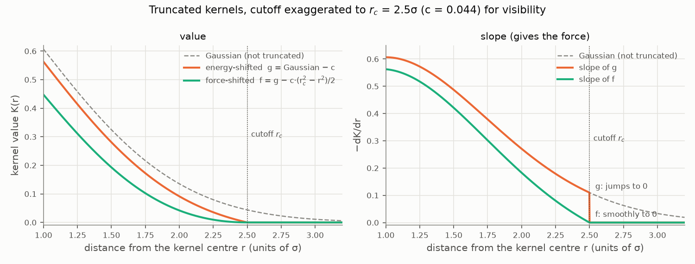
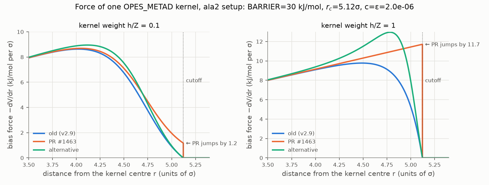
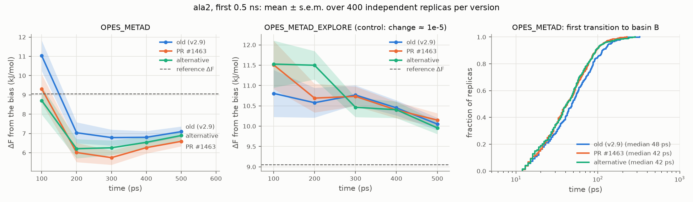

# OPES kernel cutoff: making force and bias consistent

This note compares three ways of truncating the OPES kernels. It covers the original
code (PLUMED v2.9), the change proposed in
[plumed/plumed2#1463](https://github.com/plumed/plumed2/pull/1463), and an alternative.
It explains what each choice does to the bias and to the forces, and reports the tests
done with this repository.

**Summary.** The original code computes forces that are not exactly minus the gradient of
its own bias. Both consistent fixes (the PR and the alternative) make the bias force
slightly stronger in the kernel tails. This gives a small, measurable change in the
first ~0.5 ns of ala2: the first transition comes earlier and the new basin is
transiently over-filled. Nothing changes after ~1–2 ns or for OPES_METAD_EXPLORE.
The two fixes are statistically indistinguishable in sampling. They differ in what else
they change: the PR introduces a force jump at the cutoff, while the alternative changes
the bias values and kernel heights slightly.

## 1. Bias, kernels and cutoff

With kernels of height $h_k$, centre $\mathbf{c}_k$ and width $\boldsymbol\sigma_k$, the
OPES_METAD bias is

$$
V(\mathbf s) = a \log\Big(\frac{1}{Z}\sum_k h_k K(r_k) + \epsilon\Big),
\qquad a = \Big(1-\frac1\gamma\Big)\frac1\beta,
\qquad r_k^2 = \sum_i \Big(\frac{s_i-c_{k,i}}{\sigma_{k,i}}\Big)^2,
$$

so that the force is

$$
-\nabla V = -a\,\frac{\sum_k h_k \nabla K(r_k)}{\sum_k h_k K(r_k) + \epsilon Z}.
$$

The kernel shape $K$ enters twice: through its slope in the numerator and through its
value in the denominator.

Kernels are truncated at $r_c$ (`KERNEL_CUTOFF`). Write $c = e^{-r_c^2/2}$ for the
Gaussian at the cutoff (`val_at_cutoff_` in the code). With the default cutoff of
OPES_METAD, $r_c^2 = 2\,\mathrm{BARRIER}/((1-1/\gamma)k_BT)$, which makes $c = \epsilon$
exactly. A Gaussian cannot simply be cut at $r_c$, because the bias would jump there.
There are two standard ways to truncate it, the same used for the Lennard-Jones potential
in MD codes:

| kernel | value | slope $-\mathrm dK/\mathrm dr$ | at the cutoff |
|---|---|---|---|
| energy-shifted $g$ | $e^{-r^2/2} - c$ | $r\,e^{-r^2/2}$ | value 0, slope jumps from $r_c c$ to 0 |
| force-shifted $f$ | $e^{-r^2/2} - c\,\big(1 + \tfrac{r_c^2-r^2}{2}\big)$ | $r\,(e^{-r^2/2} - c)$ | value 0, slope 0 |



*Figure 1. Energy-shifted ($g$) and force-shifted ($f$) kernels, with the cutoff
exaggerated to $2.5\sigma$ so that the differences are visible. With the real cutoffs
(5–7σ, $c \sim 10^{-6}$–$10^{-10}$) the curves differ only in the far tail.*

## 2. The three versions

| version | kernel value (bias, denominator) | kernel slope (numerator) | force = −∇V? | force at the cutoff |
|---|---|---|---|---|
| **old** (v2.9) | $g$ | slope of $f$ | **no** | goes smoothly to 0 |
| **PR** #1463 | $g$ | slope of $g$ | yes | jumps to 0 |
| **alternative** | $f$ | slope of $f$ | yes | goes smoothly to 0 |

- **The old code mixes the two kernels.** It reports the energy-shifted bias, but its
  force is the slope of the force-shifted kernel divided by a sum of energy-shifted
  values. That force is not the gradient of any bias of the form above. For one kernel
  at 4.8σ with the ala2 parameters of Figure 2 and $h/Z = 0.1$, the force is
  3.10 kJ/mol/σ while the actual slope of the bias is 3.89 kJ/mol/σ.
- **The PR** uses $g$ everywhere: it changes only the derivative (`acc_der`), so the force
  becomes the exact gradient of the unchanged bias.
- **The alternative** uses $f$ everywhere: it keeps the original derivative and changes the
  kernel value instead, so bias and force become consistent and both vanish smoothly at
  the cutoff.

Code (the derivative overload of `evaluateKernel`; the value-only overload changes the
same way):

```c++
// PR #1463
const double gaussian=G.height*std::exp(-0.5*norm2);
for(unsigned i=0; i<ncv_; i++) {
  acc_der[i]-=dist[i]/G.sigma[i]*gaussian;
}
return gaussian-G.height*val_at_cutoff_;

// alternative (force-shifted kernel)
const double der_val=G.height*(std::exp(-0.5*norm2)-val_at_cutoff_);
for(unsigned i=0; i<ncv_; i++) {
  acc_der[i]-=dist[i]/G.sigma[i]*der_val;   // unchanged from v2.9
}
return der_val-G.height*val_at_cutoff_*0.5*(cutoff2_-norm2);
```

The PR also changes how kernel variances are merged (centred second moments, avoiding a
cancellation for narrow kernels far from the origin). That change is algebraically
identical and only affects round-off; the alternative includes it unchanged.

### Why both fixes push harder than the old code

Inside the cutoff the energy-shifted kernel is steeper and larger, $|g'| \ge |f'|$ and
$g \ge f \ge 0$:

- The PR keeps the old denominator and puts the steeper slope $g'$ in the numerator, so
  the force goes up.
- The alternative keeps the old numerator and puts the smaller value $f$ in the
  denominator, so the force goes up too.

For a single kernel, and in general wherever the kernels push in the same direction, the
old force is the weakest of the three everywhere inside the cutoff. In other words, the
old code under-pushes in the kernel tails. No consistent version can reproduce it: that
would require a kernel with value $g$ and slope $f'$ at the same time.



*Figure 2. Bias force from one kernel near the cutoff, with the parameters of the ala2
runs (BARRIER = 30 kJ/mol, T = 300 K, $r_c = 5.12\sigma$, $c = \epsilon = 2\cdot10^{-6}$),
for a light ($h/Z = 0.1$) and a heavy ($h/Z = 1$) kernel. Kernels are expected to be
heavier early in a run, when there are few of them.*

Where the two fixes differ:

- **PR:** the force is changed mostly in the last fraction of a σ before the cutoff, where
  it then drops to zero. The jump is $\approx a\,(h/Z)\,r_c/\sigma$ when $c = \epsilon$:
  1.2 kJ/mol/σ for $h/Z = 0.1$, 11.7 kJ/mol/σ for $h/Z = 1$. Bias values, kernel heights,
  KERNELS and STATE files are unchanged, so post-processing tools (e.g. `FES_from_State.py`)
  remain exactly consistent.
- **Alternative:** the force is continuous, but it is stronger in the 4–5σ shell, by an
  amount proportional to $h/Z$. The kernel tails change, and so do the bias values and the
  heights of newly deposited kernels (their weight is $e^{\beta V}$). In the bulk the
  relative change is about $c\,r_c^2/2 \approx 3\cdot10^{-5}$, but in low-barrier tests
  with very few kernels it is large (see the regtests below). Strictly, tools that rebuild
  the bias from STATE files would need the same kernel shape.

**OPES_METAD_EXPLORE.** Here $c = e^{-\mathrm{BARRIER}/k_BT}$ is far below
$\epsilon = e^{-\mathrm{BARRIER}/((\gamma-1)k_BT)}$ (for ala2, $6\cdot10^{-6}$ vs 0.34).
Both fixes change the force by about $10^{-5}$ relative, which is negligible.

## 3. Tests

All runs use this repository (`uv run opesval ...`).

Builds:

| label | source | commit |
|---|---|---|
| `v2.9-base` | v2.9 at the PR's merge-base | `d650dbd` |
| `pr1463` | head of plumed/plumed2#1463 when tested (it has moved since) | `db57633` |
| `alt-fshift` | branch [`opes-force-shifted-kernel`](https://github.com/invemichele-peptone/plumed2/tree/opes-force-shifted-kernel) of invemichele-peptone/plumed2 | `7d11c95` |

The alternative branch has two commits on top of `d650dbd`: the PR's merge fix with its
regtest, and the force-shifted kernel with the PR's finite-difference regtest. GROMACS
2024.3 is patched in runtime mode, so all three builds run with the same GROMACS binary.

### Regtests

Both new regtests from the PR pass with the alternative. `rt-opes-kernel-derivative`
compares the forces with finite differences of the bias; `rt-opes-merge-stability` checks
the merging. Existing OPES regtests whose references change:

| test | PR: largest relative force change | alternative: largest relative force change |
|---|---|---|
| `rt-opes_metad-excluded` | 564% | 43% (and kernel heights up to 27%) |
| `rt-opes_metad-target` | 21% | 54% (kernel heights up to 10%) |
| `rt-opes_metad-extra` | 2.3% | 9.1% (kernel heights up to 0.8%) |
| `rt-opes_metad-bis` | 26% | unchanged |
| `rt-opes_metad`, `-restart`, `rt-opes_metad_explore`, ... | last digits | last digits (≤ 4·10⁻⁵) |

The PR updates force references in 13 tests and nothing else. The alternative changes
5 tests, and in those it also changes bias values and kernel files. The large changes
are in tests with BARRIER = 20 kJ/mol, PACE = 5 and a handful of kernels, where every
kernel is heavy.

### Sampling: early transient of ala2

These are the runs where a difference shows up. The test is ala2 in vacuum with the
OPES_METAD and OPES_METAD_EXPLORE inputs of the Explore paper. There are 500 replicas
× 0.5 ns per version (`transient` tier); the tables use the 400 replicas (100–499) that
were not looked at before the comparison was planned. ΔF is the bias estimate, in kJ/mol;
the reference is 9.05 kJ/mol.

| OPES_METAD | 100 ps | 200 ps | 300 ps | 400 ps | 500 ps | mean 200–500 ps | median first transition |
|---|---|---|---|---|---|---|---|
| old | 11.03 ± 0.79 | 7.04 ± 0.54 | 6.78 ± 0.41 | 6.80 ± 0.33 | 7.09 ± 0.27 | 6.93 ± 0.38 | 48 ps |
| PR | 9.32 ± 0.75 | 6.01 ± 0.50 | 5.74 ± 0.37 | 6.26 ± 0.31 | 6.59 ± 0.26 | 6.15 ± 0.35 | 42 ps |
| alternative | 8.71 ± 0.73 | 6.21 ± 0.50 | 6.26 ± 0.38 | 6.54 ± 0.29 | 6.89 ± 0.24 | 6.47 ± 0.34 | 42 ps |

Mann–Whitney U test:

| comparison | mean ΔF over 200–500 ps | first transition |
|---|---|---|
| PR vs old | p = 0.03 | p = 0.02 |
| alternative vs old | p = 0.05 | p = 0.01 |
| PR vs alternative | p = 0.77 | – |

For OPES_METAD_EXPLORE, the mean over 200–500 ps is 10.46, 10.49 and 10.58 ± 0.13 kJ/mol,
with p ≥ 0.4 for all pairs.



*Figure 3. Left: running ΔF in the first 0.5 ns, mean ± s.e.m. over 400 replicas. Middle:
the same for OPES_METAD_EXPLORE, where the change is negligible, as a control. Right:
distribution of the time of the first transition to basin B.*

Both fixes escape the starting basin earlier and then over-fill basin B slightly. ΔF
undershoots the reference by 0.5–1 kJ/mol more than the old code during the first
0.5 ns, and the gap closes by ~2 ns (100-replica runs: −0.2 ± 0.2 kJ/mol at 2 ns).
This is what the stronger tail forces of Figure 2 would do. The PR's effect is somewhat
larger at 200–500 ps and the alternative's at 100 ps, but the two cannot be distinguished.

The effect was first noticed in a 10-replica run, where 4 of 10 PR replicas over-filled
basin B against 1 of 10 for the old code. With 400 replicas the counts are 118 and 102
(alternative: 110), so that first impression was mostly noise. The systematic shift
shown above is real, but much smaller.

### Sampling: everything else

The `quick` tier runs all systems of the OPES and Explore papers:

- Wolfe–Quapp: 100 replicas.
- Müller–Brown: 25 replicas, OPES_METAD and OPES_METAD_EXPLORE.
- ala2: 10 replicas × 10 ns, three inputs.
- ala4: 10 replicas × 20 ns.

It compares ΔF at several times, the errors against the reference, first-transition
times, transition counts and final kernel numbers. Tests with p < 0.01, out of 128:

| comparison | tests with p < 0.01 |
|---|---|
| old vs PR | 0 |
| old vs alternative | 2 |
| PR vs alternative | 1 |

About 1.3 are expected by chance. No difference in converged ΔF, kernel counts or
transition rates.

### Performance

A fixed trajectory was replayed with `plumed driver`, with 9 runs per build in rotating
order. The table gives the time spent in the OPES action, relative to the old code:

| case | old | PR | alternative |
|---|---|---|---|
| ala2, 2D bias | 0.163 s | +1.6% | +1.2% |
| ala2, 1D, no compression (~10⁴ overlapping kernels) | 0.430 s | +0.5% | +2.1% |
| ala4, 6D bias | 0.968 s | +1.9% | +1.8% |

Run-to-run spread is about 0.5%. The alternative adds one multiply-add per kernel inside
the cutoff, and only kernels inside the cutoff are affected. The PR adds no work per
kernel, yet is as slow in two of three cases, so differences of this size probably come
from compiled code layout. Total run times differ by ≤ 1%.

## 4. Options

1. **Accept the PR.** It is the simplest change, and bias values, kernel files and
   post-processing are untouched. The cost is a force discontinuity at the cutoff, which
   is large for heavy kernels, and a slightly faster early exploration with a transient
   over-filling.
2. **Use the alternative.** Forces are continuous (better behaved in MD, e.g. without a
   thermostat), and the sampling is the same as with the PR. The cost is that bias values
   and kernel heights change slightly, more regtest references change, and STATE
   post-processing would strictly need the new kernel shape.
3. **Keep the old code and document it.** The sampling stays exactly as it is today, but
   forces remain inconsistent with the reported bias in the tails.
4. **Combined with any of the above: a larger default `KERNEL_CUTOFF`.**
   - Since $c = e^{-r_c^2/2}$, one extra σ at $r_c \approx 5$ shrinks $c$ about 250-fold,
     and all three versions converge to the untruncated Gaussian.
   - The cost is evaluating more kernels per step, and $c$ would no longer equal $\epsilon$.

The early-time difference is the price of consistency, not a defect of either fix. The
choice between the PR and the alternative is about force continuity vs keeping the bias
and kernel files unchanged.

## 5. Reproducing

```bash
uv sync
FORK=https://github.com/invemichele-peptone/plumed2.git   # branch opes-force-shifted-kernel
build/build_plumed.sh v2.9-base d650dbd5a52ea8954950f823da5214f54bf837b5
build/build_plumed.sh pr1463 db576335168aaa9d22d7f22f23169d39fbf0146f   # #1463 as tested
build/build_plumed.sh alt-fshift 7d11c954e4adac8315479ea2933dd5c5c53a6037 $FORK
# later commits of the branch select the variant with CUTOFF_SCHEME, e.g. --opes-extra CUTOFF_SCHEME=ALTERNATIVE
build/build_gromacs.sh 2024.3 v2.9-base
build/make_tprs.sh ala2 2024.3 500                       # replicas 100-499 are not committed

uv run opesval run -p v2.9-base pr1463 alt-fshift -s ala2 -m opes,explore -t transient
uv run opesval run -p v2.9-base pr1463 alt-fshift -t quick
uv run opesval compare v2.9-base pr1463 -t quick         # and the other pairs
uv run python docs/make_figures.py                       # figures of this note
```
