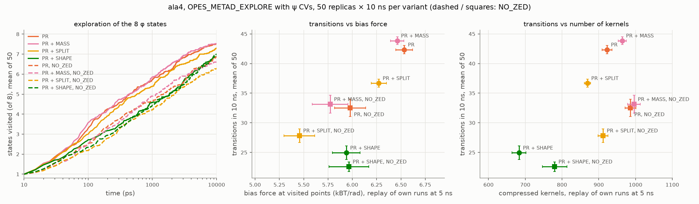

# OPES kernel compression: summing heights or weights

When OPES compresses its kernel density estimate (KDE), it merges each new kernel into a
close existing one. PLUMED (v2.9) adds the kernel **heights**. The compression scheme
OPES is based on, Sodkomkham et al. (2016), adds the kernel **weights**, i.e. the heights
times the kernel normalization. This note compares the two rules, implemented as
`MERGE_SCHEME=PLAIN|SPLIT`, and tests SPLIT together with the cutoff fix of
[plumed/plumed2#1463](https://github.com/plumed/plumed2/pull/1463)
(see [kernel-cutoff.md](kernel-cutoff.md)).

**Summary.**
- PLAIN merging inflates the total mass of the KDE by 20–37% in the runs here, more for
  kernels merged more often. SPLIT conserves it exactly.
- The normalization Z absorbs the inflation, and converged free energies do not change
  measurably.
- OPES_METAD_EXPLORE explores more slowly with SPLIT. In alanine tetrapeptide with three
  CVs and 50 replicas, transitions drop by 13% (36.7 vs 42.3 in 10 ns, p = 6·10⁻⁷).
- Two hybrid merge rules show the cause is not the mass, but weighting the merged
  centre and variance by mass rather than height:
  - conserving the mass alone changes nothing;
  - mass weighting alone cuts transitions by 41%.
- Mass weighting lets old, wide kernels dominate the new narrow ones. The compressed
  KDE stays coarser as σ shrinks: fewer kernels, a smoother bias, slower exploration.
- In OPES_METAD, SPLIT partly undoes the PR's early-time shift.

## 1. Heights and weights

A new kernel is deposited with weight $w = e^{\beta V}$ (OPES_METAD, or $w = 1$ for
OPES_METAD_EXPLORE) and width $\boldsymbol\sigma$. Its height is

$$
h = w \prod_i \frac{\sigma_{0,i}}{\sigma_i},
$$

i.e. the weight divided by the Gaussian normalization, up to the constant
$(2\pi)^{d/2}\prod_i\sigma_{0,i}$. That constant cancels in $P/Z$. The mass of a kernel,
its integral, is therefore $\propto h\prod_i\sigma_i \propto w$. Because adaptive σ shrinks
during a run, new kernels are narrower and taller than the old kernels they merge into.

Merging kernel 2 into kernel 1, with merge weights $m_k$:

$$
c = \frac{m_1 c_1 + m_2 c_2}{m_1+m_2},\qquad
\sigma_i^2 = \frac{m_1\sigma_{1,i}^2 + m_2\sigma_{2,i}^2}{m_1+m_2} + \frac{m_1 m_2}{(m_1+m_2)^2}(c_{2,i}-c_{1,i})^2
$$

| | merge weight $m_k$ | merged height | conserved |
|---|---|---|---|
| **PLAIN** (v2.9) | $h_k$ | $h_1 + h_2$ | sum of heights |
| **SPLIT** (Sodkomkham et al.) | $h_k\prod_i\sigma_{k,i}$ | $(m_1+m_2)/\prod_i\sigma_i$ | mass, mean and variance of the pair |

SPLIT is the standard moment-matching reduction of a Gaussian mixture. PLAIN differs in
two ways:

- **Extra mass:** every merge broadens the kernel while keeping the sum of heights, so it
  adds mass. Two equal kernels 1σ apart give $\sigma = 1.12\sigma_0$ and 12% more mass in
  1D; in more dimensions the factors multiply.
- **Bias towards narrow kernels:** centre and variance are weighted by height, which
  favours narrow, tall kernels. Old wide kernels get pulled towards the new narrow ones,
  and come out narrower than the mixture they replace.


*Figure 1. Left: equal kernels at the compression threshold (1σ). PLAIN adds 12% mass.
Right: an old wide kernel and a new narrow one of equal mass, the typical case later in a
run. PLAIN adds 14% mass, moves the centre towards the narrow kernel (+0.10 instead of 0)
and gives a narrower result (σ = 0.76 instead of 0.85).*

## 2. Implementation

The rule is selected by `MERGE_SCHEME=PLAIN|SPLIT` on the local branch
`opes-force-shifted-kernel` (commit `740f1fe`, then `a7ac61f`), together with
`CUTOFF_SCHEME=PLAIN|PR|ALTERNATIVE`. Defaults reproduce v2.9.

Commit `a7ac61f` adds two hybrids, to separate the two changes in SPLIT:

- `MASS`: centre and variance weighted by height, as in PLAIN, but the merged height
  conserves the mass.
- `SHAPE`: centre and variance weighted by mass, as in SPLIT, but the heights are summed,
  as in PLAIN.

The merge for PLAIN and SPLIT, as in `OPESmetad::mergeKernels` at `740f1fe`:

```c++
double m1=k1.height;
double m2=k2.height;
if(merge_split_) {  // the mass of each kernel, up to a constant
  for(unsigned i=0; i<k1.center.size(); i++) {
    m1*=k1.sigma[i];
    m2*=k2.sigma[i];
  }
}
const double m=m1+m2;
// ... centre and variance as above, with weights m1/m and m2/m ...
if(merge_split_) {
  double norm=1;
  for(unsigned i=0; i<k1.center.size(); i++) {
    norm*=k1.sigma[i];  // the merged sigma
  }
  k1.height=m/norm;
} else {
  k1.height=m;
}
```

Checks:

- With default keywords, all 40 OPES regtests pass against the v2.9 references.
- `rt-opes-merge-stability` (translation invariance) passes with both merge rules.
- `CUTOFF_SCHEME=PR` reproduces the PR build to within 10⁻¹⁴ on a fixed trajectory.
- With SPLIT, the total mass $\sum_k h_k\prod_i\sigma_{k,i}$ of the compressed kernels
  equals that of all deposited kernels (ratio 1.000000), checked from the STATE and
  KERNELS files. MASS also conserves it. SHAPE conserves the sum of heights, and its
  mass grows 1.7–2.9-fold in short runs. There is no regtest for this yet.
- `opesval/replay.py` re-compresses the deposited kernels of a KERNELS file with any of
  the four rules, offline. It reproduces the STATE files written by PLUMED to
  10⁻¹²–10⁻¹⁶ for all rules, in 1D and periodic 2D. For OPES_METAD_EXPLORE the
  deposited kernels do not depend on the bias, so the replay compares the rules on
  exactly the same trajectory.

## 3. Results

Runs: `pr1463` (PR cutoff, PLAIN merge) and `schemes` with
`CUTOFF_SCHEME=PR MERGE_SCHEME=SPLIT` (PR + SPLIT), on the same inputs and seeds. The
baseline is v2.9 at `d650dbd`.

### Mass of the KDE


*Figure 2. Total mass of the compressed kernels relative to that of all deposited
kernels, along the quick-tier runs.*

| | Wolfe–Quapp | Müller–Brown OPES | Müller–Brown EXPLORE | ala2 (OPES paper) | ala2 OPES | ala2 EXPLORE |
|---|---|---|---|---|---|---|
| mass inflation at the end, PLAIN | 1.28 | 1.28 | 1.37 | 1.20 | 1.27 | 1.30 |
| Z ratio at the end, PR + SPLIT / PR | 0.78 | 0.77 | 0.72 | 0.82 | 0.77 | 0.76 |

The inflation is not uniform: kernels in long-sampled regions have been merged many
times, kernels at the edge of the explored region hardly at all. The normalization Z
shrinks by the inverse of the inflation (0.78 ≈ 1/1.28, 0.72 ≈ 1/1.37, ...). So $P/Z$,
and the bias, changes only where the inflation differs from its average.

### Normalization Z

$Z$ is the average of the KDE over the kernel centres. It generally decreases as the
explored region grows and the probability spreads over it.


*Figure 3. Z along the quick-tier runs, geometric mean over replicas. Between replicas,
the final Z varies by a factor of 1.1–1.9 in the 1D and fixed-σ runs, and by 15–70 with
adaptive σ in 2–3D (ala2 with the Explore settings, ala4).*


*Figure 4. Z(PR + SPLIT) / Z(PR), compared replica by replica (yellow), and the inverse
of the mass inflation of the PLAIN merge (dashed, from the STATE and KERNELS files of
the PR runs).*

- **The ratio follows 1/inflation along the entire run**, in all six systems with STATE
  output: 0.78 vs 0.78, 0.77 vs 0.78, 0.72 vs 0.73, 0.82 vs 0.83, 0.77 vs 0.79, 0.76 vs
  0.77 at the end. It is the quantitative basis for the argument that Z absorbs the mass
  inflation, and that $P/Z$ changes only where the inflation is not uniform.
- **Why the ratio is taken replica by replica.** Two runs with the same replica index
  share their adaptive σ0, which is set from the unbiased start before any merge (checked
  in the STATE files). σ0 sets the overall scale of Z, which therefore differs a lot
  between replicas but not within a pair: the per-pair ratio is much less noisy than the
  ratio of averages.
- **ala4** has no STATE output, so there is no inflation curve.
  - **OPES_METAD:** Z is the same with both rules (paired ratio 1.01 ± 0.10). With these
    settings it keeps ~15000 kernels, so few merges happen, and its exploration does not
    change either.
  - **OPES_METAD_EXPLORE:** compression is effective (~2300 kernels), Z is 23% lower with
    SPLIT (paired ratio 0.77), and exploration slows down.

### Quick tier, all systems

Mean ± s.e.m. over replicas (Wolfe–Quapp 100, Müller–Brown 25, ala2 and ala4 10). The
p-value compares PR + SPLIT with PR (Welch or Mann–Whitney, the smaller). ΔF is in kBT
for the 2D models and kJ/mol for ala2; the references are 3.32 kBT, 5.71 kBT and
9.05 kJ/mol.

| system / method | metric | v2.9 | PR | PR + SPLIT | p |
|---|---|---|---|---|---|
| Wolfe–Quapp | final ΔF | 3.31 ± 0.11 | 3.42 ± 0.10 | 3.21 ± 0.11 | 0.09 |
| Müller–Brown, OPES | final ΔF | 2.86 ± 0.41 | 3.24 ± 0.49 | 3.20 ± 0.47 | 0.83 |
| Müller–Brown, EXPLORE | transitions | 34 ± 2.8 | 32 ± 3.2 | 29 ± 2.3 | 0.45 |
| ala2, OPES paper | final ΔF | 9.06 ± 0.07 | 8.87 ± 0.08 | 8.97 ± 0.04 | 0.29 |
| ala2, OPES paper | ΔF error, 2nd half | 0.28 ± 0.05 | 0.32 ± 0.09 | 0.18 ± 0.02 | 0.14 |
| ala2, OPES | final ΔF | 8.83 ± 0.14 | 8.68 ± 0.26 | 8.63 ± 0.15 | 0.68 |
| ala2, EXPLORE | transitions | 696 ± 12 | 681 ± 11 | 655 ± 9 | 0.08 |
| ala4, OPES | states visited at 20 ns | 7.3 ± 0.3 | 7.2 ± 0.3 | 7.4 ± 0.2 | 0.56 |
| **ala4, EXPLORE** | **transitions** | 61.9 ± 1.9 | 59.3 ± 1.9 | **47.7 ± 1.8** | **3·10⁻⁴** |
| **ala4, EXPLORE** | **states visited at 5 / 10 ns** | 7.5 / 7.8 | 7.3 / 7.6 | **6.3 / 6.8** | 0.01 / 0.03 |
| ala4, EXPLORE | replicas that visited all 8 states | 8/10 | 8/10 | 5/10 | 0.07 |
| ala4, EXPLORE | compressed kernels | 2310 ± 31 | 2310 ± 19 | 2090 ± 14 | 7·10⁻⁸ |

Of 128 tests, 10 differ at p < 0.01 between PR and PR + SPLIT. They are:

- Z in four systems, expected from the mass inflation above;
- kernel counts in two;
- ala4 explore transitions;
- `rct` in two runs and `neff` in one.

No free-energy metric differs at that level.


*Figure 5. Alanine tetrapeptide biased on the three ψ dihedrals ("bad" CVs, Explore
paper): number of the 8 φ-states visited over time.*

With 50 replicas (next section), the difference in visited states turns out smaller
than these 10 replicas suggest: 7.30 vs 7.52 at 10 ns, p = 0.17. The drop in transitions
is robust.

### ala4 with 50 replicas: what slows exploration

The test is OPES_METAD_EXPLORE on ala4 with the ψ CVs, 50 replicas × 10 ns per variant
(`many` tier). It covers PR, PR + SPLIT and the two hybrids, each with and without
NO_ZED. Each run's own kernels were replayed at 5 ns to get the number of compressed
kernels and the mean bias force at the visited points (15 replicas). p-values are
Mann–Whitney or Fisher, against PR in the same group.

| variant | transitions in 10 ns | states visited at 10 ns | all 8 visited | kernels at 10 ns | kernels at 5 ns (replay) | bias force (kBT/rad) |
|---|---|---|---|---|---|---|
| PR | 42.3 ± 0.7 | 7.52 ± 0.08 | 27/50 | 1471 | 923 | 6.53 |
| PR + MASS | 43.9 ± 0.6 (p = 0.18) | 7.52 ± 0.09 | 29/50 | 1542 | 964 | 6.46 |
| PR + SPLIT | 36.7 ± 0.7 (p = 6·10⁻⁷) | 7.30 ± 0.10 (p = 0.17) | 23/50 | 1376 | 869 | 6.27 |
| PR + SHAPE | 24.9 ± 1.2 (p = 10⁻¹⁵) | 6.86 ± 0.19 (p = 0.02) | 22/50 | 1080 | 683 | 5.94 |
| PR, NO_ZED | 32.5 ± 1.5 | 6.86 ± 0.20 | 23/50 | 1572 | 986 | 5.98 |
| PR + MASS, NO_ZED | 33.1 ± 1.5 (p = 0.8) | 6.64 ± 0.20 (p = 0.39) | 20/50 | 1603 | 996 | 5.77 |
| PR + SPLIT, NO_ZED | 27.8 ± 1.1 (p = 0.015) | 6.28 ± 0.21 (p = 0.04) | 14/50 | 1447 | 911 | 5.46 |
| PR + SHAPE, NO_ZED | 22.6 ± 0.8 (p = 6·10⁻⁷) | 7.00 ± 0.18 (p = 0.74) | 24/50 | 1179 | 780 | 5.96 |



*Figure 6. Left: states visited over time, mean of 50 replicas. Middle and right:
transitions against the bias force at the visited points and against the number of
compressed kernels, both from a replay of each variant's own runs at 5 ns. Circles: with
Z; squares: NO_ZED.*

- **Mass conservation alone does nothing.** PR + MASS behaves like PR, with Z and with
  NO_ZED.
- **Mass-weighted merging slows exploration:** PR + SHAPE has 41% fewer transitions than
  PR.
- **SPLIT does both** and lands in between.
- **Removing Z slows every variant** (by 23% for PR, p = 2·10⁻⁷) but leaves the pattern
  unchanged.
- **Kernel count predicts exploration best.** Within each group, transitions rise
  monotonically with the number of compressed kernels. The bias force ranks the variants
  with Z, but not SHAPE with NO_ZED.

### Early transient of ala2

These are 400 independent replicas × 0.5 ns per version (replicas 100–499 of the
`transient` tier), as in [kernel-cutoff.md](kernel-cutoff.md). ΔF is in kJ/mol;
p-values are from the Mann–Whitney U test.

| OPES_METAD | ΔF at 300 ps | mean ΔF 200–500 ps | median first transition | replicas over-filling basin B |
|---|---|---|---|---|
| v2.9 | 6.78 ± 0.41 | 6.93 ± 0.38 | 48 ps | 102/400 |
| PR | 5.74 ± 0.37 | 6.15 ± 0.35 (p = 0.03 vs v2.9) | 42 ps (p = 0.02) | 118/400 |
| PR + SPLIT | 6.37 ± 0.38 | 6.57 ± 0.34 (p = 0.08 vs v2.9, 0.66 vs PR) | 46 ps (p = 0.24) | 103/400 |

With OPES_METAD_EXPLORE, PR + SPLIT is slightly slower to make the first transition than
the PR (31 vs 27 ps, p = 0.06). Its mean ΔF over 200–500 ps does not differ significantly
(10.73 vs 10.49 kJ/mol, p = 0.36).


*Figure 7. Left and middle: running ΔF in the first 0.5 ns. Right: first transition to
basin B, OPES_METAD.*

## 4. Interpretation

**It is not the mass.**
- The mass inflation of PLAIN is large (Figure 2), but Z absorbs it (Figure 4).
- PR + MASS, which conserves the mass with the PLAIN shape, explores exactly like PR,
  even with NO_ZED. Without Z, the replay shows its bias at the visited points sitting
  ~2 kBT lower than PR's, with no visible effect on exploration.
- *Correction:* an earlier version of this note attributed the slowdown to the
  inflation acting through Z, as an extra bias contrast of $a\log 1.3 \approx 5$ kBT.
  The hybrids rule that out.

**It is the weighting of the merge.**
- Kernel heights scale as $1/\prod_i\sigma_i$, so new narrow kernels are tall but carry
  little mass, while old wide kernels carry most of it (Figure 1, right).
- With mass weights, the old kernel dominates the merge: the result keeps a large σ and
  barely moves.
- With height weights, the new kernel dominates: merged kernels follow the newest,
  narrowest deposits.
- Adaptive σ shrinks steadily during a run: in ala4 explore, new kernels are 0.18× as
  wide after 19 ns as at the start. Mass weighting therefore keeps the compressed KDE at
  the resolution of the early, broad kernels. The result is fewer kernels (683 for
  SHAPE, 869 for SPLIT, 923 for PR at 5 ns), a smoother bias, weaker forces at the
  visited points (5.94, 6.27, 6.53 kBT/rad) and fewer transitions.
- SHAPE also sums the heights, which gives those broad kernels extra mass on top, so
  they dominate the KDE even more. SPLIT conserves the mass and sits between PR and
  SHAPE. Conserving the mass matters only when the merge is mass-weighted.

**Why OPES_METAD_EXPLORE.** Its kernels are wider (with adaptive σ, OPES_METAD divides
the variance by γ, explore does not) and shrink with the number of kernels, not with
the effective sample size. So many more merges happen, between kernels of very different
widths. In ala4, OPES_METAD keeps ~15000 kernels against ~2300 for explore. That is
exactly where the merge weighting matters, and OPES_METAD is not affected.

**Why free energies don't change.** Within a basin, kernels are compressed to a similar
degree, so the inflation is nearly uniform there and cancels with Z. The difference in
resolution affects the bias mostly at the edges of the explored region. Converged ΔF is
the same within errors. The ala2 OPES-paper case has a smaller error with SPLIT (0.18
vs 0.32 kJ/mol), but not significantly (p = 0.14).

**The static replay is only a guide.** Replaying the PR trajectories with each rule
gives the right direction, but underestimates SHAPE: about 10% weaker forces than PR,
against 41% fewer transitions in the actual runs. The dynamics feeds back: a slower
walker spends longer in its basins, where more merges with broad kernels happen.

**In short.** SPLIT is the consistent compression: it conserves mass, mean and variance,
and the free energy estimate is at least as good. Its slower exploration in
OPES_METAD_EXPLORE comes from the mass-weighted merge, which keeps the KDE coarser as σ
shrinks, not from removing the mass inflation. The MASS hybrid keeps PLAIN's speed and
conserves the mass, but it does not preserve the mean and variance of the merged pair.
Whether a smaller COMPRESSION_THRESHOLD would recover the resolution with SPLIT is
untested.

## 5. Open points

- Not run yet: SPLIT with the v2.9 cutoff (`MERGE_SCHEME=SPLIT` alone),
  `CUTOFF_SCHEME=ALTERNATIVE MERGE_SCHEME=SPLIT`, and SPLIT with a smaller
  COMPRESSION_THRESHOLD.
- The 50-replica test covers ala4 with OPES_METAD_EXPLORE only. The other systems rest
  on the quick tier.
- A regtest for mass conservation with SPLIT is needed before proposing it upstream.
- The full tier (paper lengths) would tighten the converged-ΔF comparison.

## 6. Reproducing

```bash
uv sync
build/build_plumed.sh v2.9-base d650dbd5a52ea8954950f823da5214f54bf837b5
build/build_plumed.sh pr1463 pr/1463
build/build_plumed.sh schemes 740f1fe11dcffcb0b8fc626f3ac30b64356d9af2 /path/to/plumed2
build/build_plumed.sh schemes2 a7ac61f33bb9d73fceba0f316bc3cb57aac45f59 /path/to/plumed2
build/build_gromacs.sh 2024.3 v2.9-base
build/make_tprs.sh ala2 2024.3 500
build/make_tprs.sh ala4 2024.3 50

uv run opesval run -p v2.9-base pr1463 -t quick
uv run opesval run -p schemes -t quick --opes-extra "CUTOFF_SCHEME=PR MERGE_SCHEME=SPLIT"
uv run opesval run -p v2.9-base pr1463 -s ala2 -m opes,explore -t transient
uv run opesval run -p schemes -s ala2 -m opes,explore -t transient --opes-extra "CUTOFF_SCHEME=PR MERGE_SCHEME=SPLIT"
uv run opesval compare pr1463 schemes+cutoff_scheme-pr+merge_scheme-split -t quick
for z in "" " NO_ZED"; do  # ala4, 50 replicas: run set names as read by make_figures.py
  uv run opesval run -p schemes -s ala4 -m explore -t many --opes-extra "CUTOFF_SCHEME=PR$z"
  uv run opesval run -p schemes -s ala4 -m explore -t many --opes-extra "CUTOFF_SCHEME=PR MERGE_SCHEME=SPLIT$z"
  for m in MASS SHAPE; do uv run opesval run -p schemes2 -s ala4 -m explore -t many --opes-extra "CUTOFF_SCHEME=PR MERGE_SCHEME=$m$z"; done
done
uv run python docs/make_figures.py   # all figures
```

Reference: D. Sodkomkham, D. Ciliberti, M. A. Wilson, K. Fukui, K. Moriyama, M. Numao,
F. Kloosterman, *Kernel density compression for real-time Bayesian encoding/decoding of
unsorted hippocampal spikes*, Knowledge-Based Systems 94, 1 (2016).
