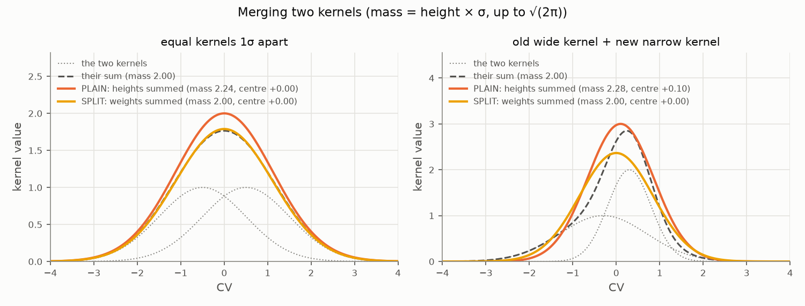
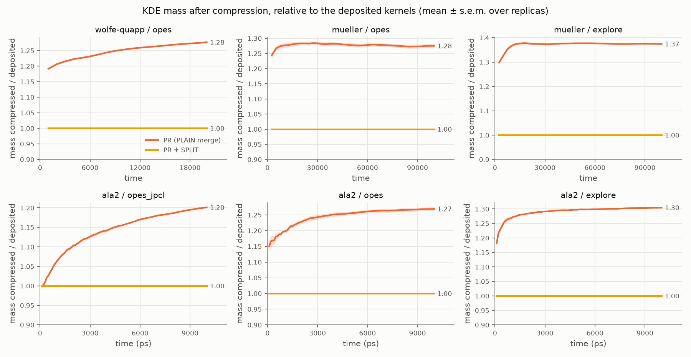
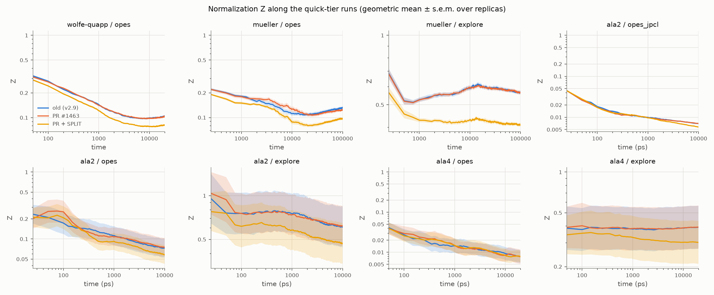
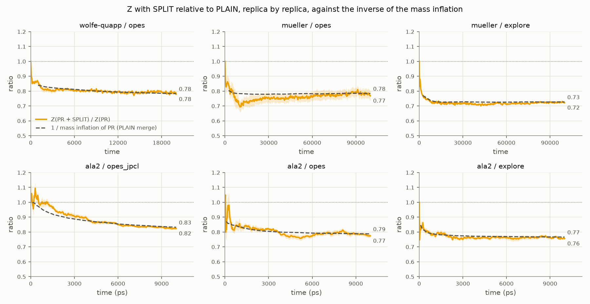
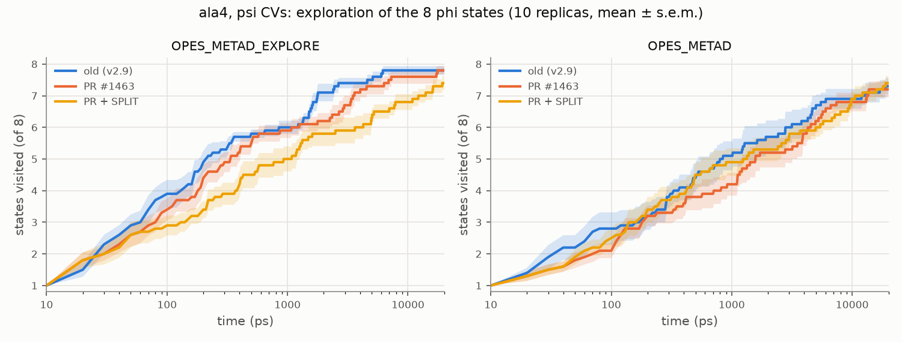
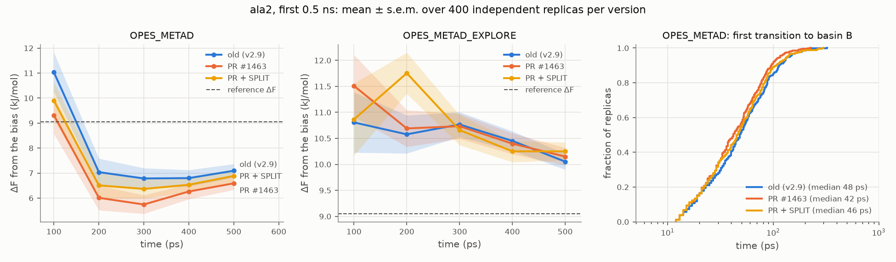

# OPES kernel compression: summing heights or weights

When OPES compresses its kernel density estimate (KDE), it merges each new kernel into a
close existing one. PLUMED (v2.9) adds the kernel **heights**. The compression scheme
OPES is based on, Sodkomkham et al. (2016), adds the kernel **weights**, i.e. the heights
times the kernel normalization. This note compares the two rules, implemented as
`MERGE_SCHEME=PLAIN|SPLIT`, and tests SPLIT together with the cutoff fix of
[plumed/plumed2#1463](https://github.com/plumed/plumed2/pull/1463)
(see [kernel-cutoff.md](kernel-cutoff.md)).

**Summary.** PLAIN merging inflates the total mass of the KDE: by 20–37% in the runs
here, more for kernels merged more often. SPLIT conserves it exactly. The
normalization Z absorbs most of the inflation, so converged free energies do not
change measurably. OPES_METAD_EXPLORE, however, explores more slowly with SPLIT:
clearly so for alanine tetrapeptide with three CVs (47.7 vs 59.3 transitions in 20 ns,
p = 3·10⁻⁴), with a weaker trend elsewhere. In OPES_METAD, SPLIT partly undoes the PR's
early-time shift.

## 1. Heights and weights

A new kernel is deposited with weight $w = e^{\beta V}$ (OPES_METAD, or $w = 1$ for
OPES_METAD_EXPLORE) and width $\boldsymbol\sigma$. Its height is

$$
h = w \prod_i \frac{\sigma_{0,i}}{\sigma_i},
$$

i.e. the weight divided by the Gaussian normalization, up to the constant
$(2\pi)^{d/2}\prod_i\sigma_{0,i}$. That constant cancels in $P/Z$. The mass of a kernel,
its integral, is therefore $\propto h\prod_i\sigma_i \propto w$. Because adaptive σ shrinks
during a run, new kernels are narrower and taller than the old kernels they merge into.

Merging kernel 2 into kernel 1, with merge weights $m_k$:

$$
c = \frac{m_1 c_1 + m_2 c_2}{m_1+m_2},\qquad
\sigma_i^2 = \frac{m_1\sigma_{1,i}^2 + m_2\sigma_{2,i}^2}{m_1+m_2} + \frac{m_1 m_2}{(m_1+m_2)^2}(c_{2,i}-c_{1,i})^2
$$

| | merge weight $m_k$ | merged height | conserved |
|---|---|---|---|
| **PLAIN** (v2.9) | $h_k$ | $h_1 + h_2$ | sum of heights |
| **SPLIT** (Sodkomkham et al.) | $h_k\prod_i\sigma_{k,i}$ | $(m_1+m_2)/\prod_i\sigma_i$ | mass, mean and variance of the pair |

SPLIT is the standard moment-matching reduction of a Gaussian mixture. PLAIN differs in
two ways:

- **Extra mass:** every merge broadens the kernel while keeping the sum of heights, so it
  adds mass. Two equal kernels 1σ apart give $\sigma = 1.12\sigma_0$ and 12% more mass in
  1D; in more dimensions the factors multiply.
- **Bias towards narrow kernels:** centre and variance are weighted by height, which
  favours narrow, tall kernels. Old wide kernels get pulled towards the new narrow ones,
  and come out narrower than the mixture they replace.



*Figure 1. Left: equal kernels at the compression threshold (1σ). PLAIN adds 12% mass.
Right: an old wide kernel and a new narrow one of equal mass, the typical case later in a
run. PLAIN adds 14% mass, moves the centre towards the narrow kernel (+0.10 instead of 0)
and gives a narrower result (σ = 0.76 instead of 0.85).*

## 2. Implementation

The rule is selected by `MERGE_SCHEME=PLAIN|SPLIT` on the local branch
`opes-force-shifted-kernel`, commit `740f1fe`, together with
`CUTOFF_SCHEME=PLAIN|PR|ALTERNATIVE`. Defaults reproduce v2.9. The merge, as in
`OPESmetad::mergeKernels`:

```c++
double m1=k1.height;
double m2=k2.height;
if(merge_split_) {  // the mass of each kernel, up to a constant
  for(unsigned i=0; i<k1.center.size(); i++) {
    m1*=k1.sigma[i];
    m2*=k2.sigma[i];
  }
}
const double m=m1+m2;
// ... centre and variance as above, with weights m1/m and m2/m ...
if(merge_split_) {
  double norm=1;
  for(unsigned i=0; i<k1.center.size(); i++) {
    norm*=k1.sigma[i];  // the merged sigma
  }
  k1.height=m/norm;
} else {
  k1.height=m;
}
```

Checks:

- With default keywords, all 40 OPES regtests pass against the v2.9 references.
- `rt-opes-merge-stability` (translation invariance) passes with both merge rules.
- `CUTOFF_SCHEME=PR` reproduces the PR build to within 10⁻¹⁴ on a fixed trajectory.
- With SPLIT, the total mass $\sum_k h_k\prod_i\sigma_{k,i}$ of the compressed kernels
  equals that of all deposited kernels (ratio 1.000000), checked from the STATE and
  KERNELS files. There is no regtest for this yet.

## 3. Results

Runs: `pr1463` (PR cutoff, PLAIN merge) and `schemes` with
`CUTOFF_SCHEME=PR MERGE_SCHEME=SPLIT` (PR + SPLIT), on the same inputs and seeds. The
baseline is v2.9 at `d650dbd`.

### Mass of the KDE



*Figure 2. Total mass of the compressed kernels relative to that of all deposited
kernels, along the quick-tier runs.*

| | Wolfe–Quapp | Müller–Brown OPES | Müller–Brown EXPLORE | ala2 (OPES paper) | ala2 OPES | ala2 EXPLORE |
|---|---|---|---|---|---|---|
| mass inflation at the end, PLAIN | 1.28 | 1.28 | 1.37 | 1.20 | 1.27 | 1.30 |
| Z ratio at the end, PR + SPLIT / PR | 0.78 | 0.77 | 0.72 | 0.82 | 0.77 | 0.76 |

The inflation is not uniform: kernels in long-sampled regions have been merged many
times, kernels at the edge of the explored region hardly at all. The normalization Z
shrinks by the inverse of the inflation (0.78 ≈ 1/1.28, 0.72 ≈ 1/1.37, ...). So $P/Z$,
and the bias, changes only where the inflation differs from its average.

### Normalization Z

$Z$ is the average of the KDE over the kernel centres. It generally decreases as the
explored region grows and the probability spreads over it.



*Figure 3. Z along the quick-tier runs, geometric mean over replicas. Between replicas,
the final Z varies by a factor of 1.1–1.9 in the 1D and fixed-σ runs, and by 15–70 with
adaptive σ in 2–3D (ala2 with the Explore settings, ala4).*



*Figure 4. Z(PR + SPLIT) / Z(PR), compared replica by replica (yellow), and the inverse
of the mass inflation of the PLAIN merge (dashed, from the STATE and KERNELS files of
the PR runs).*

- **The ratio follows 1/inflation along the entire run**, in all six systems with STATE
  output: 0.78 vs 0.78, 0.77 vs 0.78, 0.72 vs 0.73, 0.82 vs 0.83, 0.77 vs 0.79, 0.76 vs
  0.77 at the end. It is the quantitative basis for the argument that Z absorbs the mass
  inflation, and that $P/Z$ changes only where the inflation is not uniform.
- **Why the ratio is taken replica by replica.** Two runs with the same replica index
  share their adaptive σ0, which is set from the unbiased start before any merge (checked
  in the STATE files). σ0 sets the overall scale of Z, which therefore differs a lot
  between replicas but not within a pair: the per-pair ratio is much less noisy than the
  ratio of averages.
- **ala4** has no STATE output, so there is no inflation curve.
  - **OPES_METAD:** Z is the same with both rules (paired ratio 1.01 ± 0.10). With these
    settings it keeps ~15000 kernels, so few merges happen, and its exploration does not
    change either.
  - **OPES_METAD_EXPLORE:** compression is effective (~2300 kernels), Z is 23% lower with
    SPLIT (paired ratio 0.77), and exploration slows down.

### Quick tier, all systems

Mean ± s.e.m. over replicas (Wolfe–Quapp 100, Müller–Brown 25, ala2 and ala4 10). The
p-value compares PR + SPLIT with PR (Welch or Mann–Whitney, the smaller). ΔF is in kBT
for the 2D models and kJ/mol for ala2; the references are 3.32 kBT, 5.71 kBT and
9.05 kJ/mol.

| system / method | metric | v2.9 | PR | PR + SPLIT | p |
|---|---|---|---|---|---|
| Wolfe–Quapp | final ΔF | 3.31 ± 0.11 | 3.42 ± 0.10 | 3.21 ± 0.11 | 0.09 |
| Müller–Brown, OPES | final ΔF | 2.86 ± 0.41 | 3.24 ± 0.49 | 3.20 ± 0.47 | 0.83 |
| Müller–Brown, EXPLORE | transitions | 34 ± 2.8 | 32 ± 3.2 | 29 ± 2.3 | 0.45 |
| ala2, OPES paper | final ΔF | 9.06 ± 0.07 | 8.87 ± 0.08 | 8.97 ± 0.04 | 0.29 |
| ala2, OPES paper | ΔF error, 2nd half | 0.28 ± 0.05 | 0.32 ± 0.09 | 0.18 ± 0.02 | 0.14 |
| ala2, OPES | final ΔF | 8.83 ± 0.14 | 8.68 ± 0.26 | 8.63 ± 0.15 | 0.68 |
| ala2, EXPLORE | transitions | 696 ± 12 | 681 ± 11 | 655 ± 9 | 0.08 |
| ala4, OPES | states visited at 20 ns | 7.3 ± 0.3 | 7.2 ± 0.3 | 7.4 ± 0.2 | 0.56 |
| **ala4, EXPLORE** | **transitions** | 61.9 ± 1.9 | 59.3 ± 1.9 | **47.7 ± 1.8** | **3·10⁻⁴** |
| **ala4, EXPLORE** | **states visited at 5 / 10 ns** | 7.5 / 7.8 | 7.3 / 7.6 | **6.3 / 6.8** | 0.01 / 0.03 |
| ala4, EXPLORE | replicas that visited all 8 states | 8/10 | 8/10 | 5/10 | 0.07 |
| ala4, EXPLORE | compressed kernels | 2310 ± 31 | 2310 ± 19 | 2090 ± 14 | 7·10⁻⁸ |

Of 128 tests, 10 differ at p < 0.01 between PR and PR + SPLIT. They are:

- Z in four systems, expected from the mass inflation above;
- kernel counts in two;
- ala4 explore transitions;
- `rct` in two runs and `neff` in one.

No free-energy metric differs at that level.



*Figure 5. Alanine tetrapeptide biased on the three ψ dihedrals ("bad" CVs, Explore
paper): number of the 8 φ-states visited over time.*

### Early transient of ala2

These are 400 independent replicas × 0.5 ns per version (replicas 100–499 of the
`transient` tier), as in [kernel-cutoff.md](kernel-cutoff.md). ΔF is in kJ/mol;
p-values are from the Mann–Whitney U test.

| OPES_METAD | ΔF at 300 ps | mean ΔF 200–500 ps | median first transition | replicas over-filling basin B |
|---|---|---|---|---|
| v2.9 | 6.78 ± 0.41 | 6.93 ± 0.38 | 48 ps | 102/400 |
| PR | 5.74 ± 0.37 | 6.15 ± 0.35 (p = 0.03 vs v2.9) | 42 ps (p = 0.02) | 118/400 |
| PR + SPLIT | 6.37 ± 0.38 | 6.57 ± 0.34 (p = 0.08 vs v2.9, 0.66 vs PR) | 46 ps (p = 0.24) | 103/400 |

With OPES_METAD_EXPLORE, PR + SPLIT is slightly slower to make the first transition than
the PR (31 vs 27 ps, p = 0.06). Its mean ΔF over 200–500 ps does not differ significantly
(10.73 vs 10.49 kJ/mol, p = 0.36).



*Figure 6. Left and middle: running ΔF in the first 0.5 ns. Right: first transition to
basin B, OPES_METAD.*

## 4. Interpretation

**Why the extra mass speeds up exploration.**
- PLAIN inflates the kernels in long-sampled regions more than those at the edge of the
  explored region. After dividing by Z, $P/Z$ is overestimated in the explored regions
  and underestimated at the edge, by roughly the inflation factor, 1.2–1.4.
- The bias is $V = a\log(P/Z+\epsilon)$, so the bias contrast between explored and new
  regions grows by about $a\log 1.3$.
- For OPES_METAD, $a = (1-1/\gamma)k_BT \approx k_BT$, a small effect (≈ 0.25 kBT).
- For OPES_METAD_EXPLORE, $a = (\gamma-1)k_BT$. With the ala4 settings, γ = 20, so the
  contrast grows by about 5 kBT.
- That extra push out of explored regions helps exploration. SPLIT removes it, which
  explains why OPES_METAD_EXPLORE slows down while OPES_METAD barely changes.
- The effect shows most where exploration is slow and the edge of the explored region
  persists: ala4 with bad CVs, three dimensions, where inflation compounds per dimension.

**Why there are fewer kernels.** SPLIT also merges wider kernels (Figure 1, right).
Compression captures new kernels within one σ of an existing kernel, so wider kernels
absorb more new ones: 2090 vs 2310 compressed kernels in ala4 explore.

**Why free energies don't change.** Within a basin, kernels are compressed to a similar
degree, so the inflation is nearly uniform there and cancels with Z. Converged ΔF is the
same within errors. The ala2 OPES-paper case has a smaller error with SPLIT (0.18 vs
0.32 kJ/mol), but not significantly (p = 0.14).

**In short.** SPLIT is the correct KDE compression: it conserves mass, mean and variance,
and the free energy estimate is at least as good. Part of OPES_METAD_EXPLORE's
exploration speed, as published, came from the PLAIN merge's mass inflation, and SPLIT
gives that up.

## 5. Open points

- The ala4 result rests on 10 replicas (p = 3·10⁻⁴). The plan for confirming it:
  - 50 replicas × 20 ns of explore with PR and with PR + SPLIT, about 20 min on 20 cores;
  - the extra ala4 tprs generated locally with `build/make_tprs.sh ala4 2024.3 50`.
- Not run yet: SPLIT with the v2.9 cutoff (`MERGE_SCHEME=SPLIT` alone) and
  `CUTOFF_SCHEME=ALTERNATIVE MERGE_SCHEME=SPLIT`.
- A regtest for mass conservation with SPLIT is needed before proposing it upstream.
- The full tier (paper lengths) would tighten the converged-ΔF comparison.

## 6. Reproducing

```bash
uv sync
build/build_plumed.sh v2.9-base d650dbd5a52ea8954950f823da5214f54bf837b5
build/build_plumed.sh pr1463 pr/1463
build/build_plumed.sh schemes 740f1fe11dcffcb0b8fc626f3ac30b64356d9af2 /path/to/plumed2
build/build_gromacs.sh 2024.3 v2.9-base
build/make_tprs.sh ala2 2024.3 500

uv run opesval run -p v2.9-base pr1463 -t quick
uv run opesval run -p schemes -t quick --opes-extra "CUTOFF_SCHEME=PR MERGE_SCHEME=SPLIT"
uv run opesval run -p v2.9-base pr1463 -s ala2 -m opes,explore -t transient
uv run opesval run -p schemes -s ala2 -m opes,explore -t transient --opes-extra "CUTOFF_SCHEME=PR MERGE_SCHEME=SPLIT"
uv run opesval compare pr1463 schemes+cutoff_scheme-pr+merge_scheme-split -t quick
uv run python docs/make_figures.py   # all figures
```

Reference: D. Sodkomkham, D. Ciliberti, M. A. Wilson, K. Fukui, K. Moriyama, M. Numao,
F. Kloosterman, *Kernel density compression for real-time Bayesian encoding/decoding of
unsorted hippocampal spikes*, Knowledge-Based Systems 94, 1 (2016).
