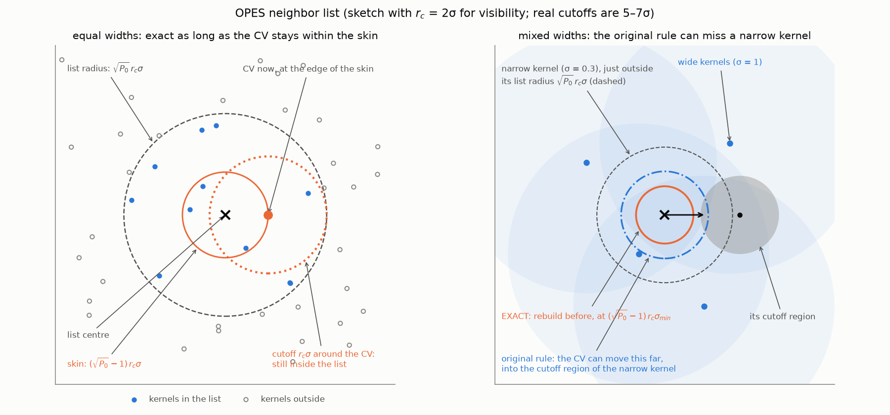
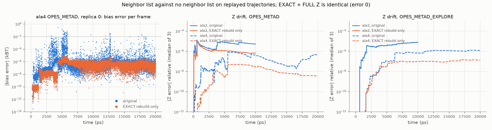
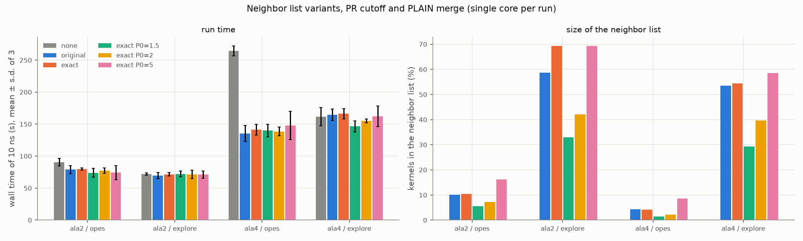
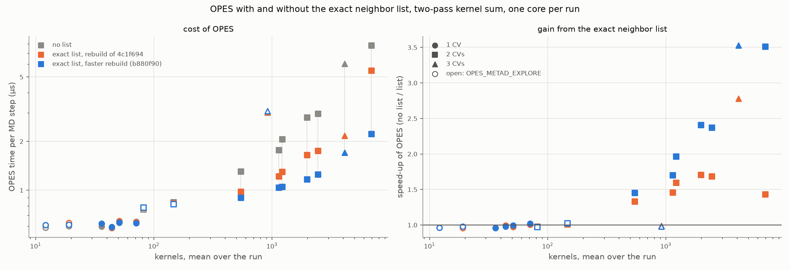

# OPES neighbor list: making it exact

With `NLIST`, OPES sums the kernels close to the current CV value only, instead of all of
them. This note shows that the neighbor list of PLUMED v2.9 is not exact, in two ways, and
tests a fix implemented as two new options. All runs use the cutoff of
[plumed/plumed2#1463](https://github.com/plumed/plumed2/pull/1463)
(`CUTOFF_SCHEME=PR`) and the v2.9 kernel merge (`MERGE_SCHEME=PLAIN`); see
[kernel-cutoff.md](kernel-cutoff.md) and [kernel-merging.md](kernel-merging.md).

**Summary.**
- **Two sources of inexactness in v2.9:**
  - The rebuild rule is a heuristic, which occasionally lets the list miss kernels
    within the cutoff. On replayed ala4 trajectories with OPES_METAD this gave errors up
    to 0.3 kBT in the bias and 44% in the force, on 0.25% of the frames.
  - The incremental update of Z uses only the kernels in the list, so Z drifts by
    10⁻⁷–10⁻⁵ in relative terms, and the error is never corrected.
- **The fix:** `NLIST_REBUILD=EXACT` rebuilds the list before any kernel outside it can
  come within the cutoff, and `NLIST_ZED=FULL` updates Z with all kernels.
- **With both, the neighbor list is exact:** in MD, all 12 runs of 10 ns are bitwise
  identical to the runs without a neighbor list. Replays with OpenMP threads, MPI
  processes and multiple walkers (`WALKERS_MPI`) also agree with no list, to round-off.
- **The cost is unmeasurable.** The speed-up is the same as with the v2.9 list:
  - 2× for OPES_METAD on ala4 (3 CVs);
  - 12–18% on ala2 (2 CVs);
  - none for OPES_METAD_EXPLORE, whose wide kernels put most of them in the list.
- **The dynamics are unchanged:** no difference on the quick tier (0 of 128 tests at
  p < 0.01).
- **With 1 or 2 CVs** (section 5), after a faster rebuild of the list (branch commit
  b880f90):
  - The list never costs anything measurable (±0.02 µs per step).
  - With 1 CV, or with OPES_METAD_EXPLORE, it brings nothing.
  - With 2 CVs and OPES_METAD, it makes OPES 1.5–3.5× faster once there are more than
    ~500 kernels. That saves up to 29% of the wall time of alanine dipeptide in vacuum.
- **Recommendation:**
  - Make the exact behaviour the only one whenever NLIST is used.
  - Then turn the list on by default, also with 1 or 2 CVs: it never slows OPES down, and
    it helps OPES_METAD from 2 CVs on.

## 1. How the neighbor list works (v2.9)

With kernels of centre $\mathbf c_k$ and width $\boldsymbol\sigma_k$, truncated at a
distance $r_c$ (`KERNEL_CUTOFF`) in units of σ, and parameters
`NLIST_PARAMETERS` $= P_0, P_1$ (default 3, 0.5):

- **Build.** The current CV value $\mathbf s$ becomes the list centre $\mathbf c_{\rm nl}$.
  The list holds every kernel with
  $\sum_i \big((c_{{\rm nl},i}-c_{k,i})/\sigma_{k,i}\big)^2 \le P_0\, r_c^2$, i.e. within
  $\sqrt{P_0}\,r_c\approx 1.7\,r_c$ in units of its own σ. For each CV it also stores
  $\mathrm{dev2}_i$, the mean of $(c_{{\rm nl},i}-c_{k,i})^2$ over the listed kernels.
- **Use.** Bias, forces and the search of the kernel to merge with run over the listed
  kernels only. New kernels are appended to the list.
- **Rebuild.** The list is rebuilt when, along any single CV,
  $(s_i-c_{{\rm nl},i})^2 > P_1\,\mathrm{dev2}_i$, and at replica exchanges.
- **Z.** After each deposition, Z is updated incrementally: only the change due to the
  new or merged kernels is added. With NLIST, the sum over the kernel centres in this
  update also runs over the listed kernels only.

In the runs here (10 ns, PR cutoff), the list holds 4–10% of the kernels with
OPES_METAD and is rebuilt every 67–128 steps. With OPES_METAD_EXPLORE it holds 54–59%,
rebuilt every 300–370 steps.

## 2. What is not exact

**The rebuild rule.**
- A kernel outside the list is farther than $\sqrt{P_0}\,r_c\,\sigma_k$ from the list
  centre. By the triangle inequality, it cannot be within the cutoff $r_c\,\sigma_k$ of
  the current CV value as long as the CV has moved less than $(\sqrt{P_0}-1)\,r_c$ from
  the list centre, in units of $\sigma_k$. This margin is the *skin*, as in the Verlet
  lists of MD codes.
- The v2.9 rule instead compares the displacement with the spread of the listed kernel
  centres, in absolute units and per CV. With kernels of different widths, which is the
  normal case since adaptive σ shrinks during a run, a narrow kernel just outside the
  list can be reached before the list is rebuilt (Figure 1, right).



*Figure 1. Left: with equal widths, the cutoff region around the CV stays inside the list
as long as the CV is within the skin. Right: a narrow kernel just outside the list; the
v2.9 rule lets the CV move into its cutoff region before rebuilding, the exact rule
rebuilds first. Sketch with $r_c = 2\sigma$; real cutoffs are 5–7σ.*

**The update of Z.**
- When a new kernel is merged into an old, wide one, the change of the wide kernel
  affects the KDE at all kernel centres within its cutoff.
- With NLIST, the incremental update evaluates this change only at the centres of listed
  kernels. Narrow kernels outside the list but within the cutoff of the wide one are
  missed.
- Since Z is never recomputed from scratch, the error accumulates. Comparing the Z in the
  STATE files of the ala2 runs with an exact recomputation from the stored kernels:

| ala2 run | relative Z error |
|---|---|
| without NLIST (control) | 10⁻¹⁴ (round-off) |
| with NLIST | 10⁻⁷–1.6·10⁻⁵, growing in time |

## 3. The fix

Two options in `OPESmetad.cpp`, on the branch
[`opes-force-shifted-kernel`](https://github.com/invemichele-peptone/plumed2/tree/opes-force-shifted-kernel) (commit `160bdfc`). The defaults (`PLAIN`) reproduce v2.9.

- **`NLIST_REBUILD=EXACT`** rebuilds when
  $\sum_i \big((s_i-c_{{\rm nl},i})/\sigma_{{\rm min},i}\big)^2 > (\sqrt{P_0}-1)^2\,r_c^2$.
  - $\sigma_{{\rm min},i}$ is the smallest σ of all kernels along CV $i$, at the last
    rebuild.
  - Kernels outside the list never change between rebuilds: merges involve only listed
    kernels, and new kernels are appended to the list. So no kernel within the cutoff is
    ever missed.
  - $P_1$ is not used.
- **`NLIST_ZED=FULL`** updates Z using all kernel centres. This costs one pass over the
  kernels per deposition, i.e. every PACE steps.

```c++
} else if(nlist_exact_rebuild_) {
  //kernels outside the list cannot be within the cutoff as long as this displacement is within the skin
  double norm2=0;
  for(unsigned i=0; i<ncv_; i++) {
    const double dist_i=difference(i,nlist_center_[i],cv[i])/nlist_sigma_min_[i];
    norm2+=dist_i*dist_i;
  }
  if(norm2>nlist_skin2_) {  // nlist_skin2_ = (sqrt(P0)-1)^2 * cutoff2_
    nlist_update_=true;
  }
}
```

**Why the smallest σ of all kernels.** A first version used the smallest σ among the
kernels outside the list only, which is enough for the guarantee. It never rebuilt the
list when all kernels were inside it, as at the start, so the list grew to contain every
kernel. That was still exact, but useless. The new regtest exposed it.

**Regtest.** The new `rt-opes-nlist-exact` runs two PLUMED instances along the same
random walk of two CVs, with the exact neighbor list and without one. It requires bias
and forces to agree to 10⁻⁹ at every step, for OPES_METAD and OPES_METAD_EXPLORE.
- It uses adaptive σ, so that kernels have different widths and most of them lie outside
  the list.
- As negative controls, it fails with `NLIST_ZED=PLAIN` and with `NLIST_REBUILD=PLAIN`.
- All 42 OPES regtests pass (the 41 existing ones and the new one):
  - with `PLUMED_NUM_THREADS` = 4 and 8;
  - with a PLUMED built with MPI, where 15 of them run on 2 MPI processes, 7 of these with
    2 walkers (`WALKERS_MPI`, one of them with NLIST).

## 4. Tests

### Exactness on replayed trajectories

The saved trajectories of three ala2 and three ala4 runs (10 and 20 ns, one frame every
500 steps) were replayed with four OPES actions side by side, one kernel per frame:
no neighbor list, the v2.9 list, EXACT rebuild only, and EXACT + FULL Z
(`build/replay_nlist.sh`). The rebuild rule is checked once per frame, i.e. every 500 MD
steps, which overstates how often the v2.9 rule misses kernels compared with MD.

| maximum over 3 replicas, vs no list | ala2 OPES_METAD | ala2 EXPLORE | ala4 OPES_METAD | ala4 EXPLORE |
|---|---|---|---|---|
| v2.9 list: bias error | 9·10⁻⁴ kBT | 2·10⁻⁴ | **0.30** (0.25% of frames > 0.01 kBT) | 3·10⁻⁵ |
| v2.9 list: force error | 0.8% | 0.03% | **44%** (0.22% of frames > 1%) | 0.003% |
| v2.9 list: Z error at the end | 1.1·10⁻⁵ | 8·10⁻⁶ | 9·10⁻⁷ | 1.5·10⁻⁶ |
| EXACT rebuild only: bias error | 3·10⁻⁵ kBT | 5·10⁻⁵ | 8·10⁻⁶ | 4·10⁻⁶ |
| EXACT rebuild only: Z error at the end | 5·10⁻⁶ | 4·10⁻⁶ | 2·10⁻⁷ | 2·10⁻⁷ |
| **EXACT + FULL Z** | **0** | **0** | **0** | **0** |



*Figure 2. Left: bias error per frame in ala4 with OPES_METAD (replica 0), v2.9 list
and EXACT rebuild only. EXACT + FULL Z has zero error and does not appear on the log
scale. Middle and right: relative Z error over time, median of 3 replicas.*

- With the exact rebuild, no kernel is missed. The remaining error of EXACT alone is the
  Z drift, which FULL removes.
- The result is bitwise identical to the run without a neighbor list: summing over the
  listed kernels skips only kernels that contribute exactly zero.

### Parallel runs: OpenMP, MPI and multiple walkers

The same replay was repeated with a PLUMED built with MPI (OpenMPI 4.1.6), in several
parallel layouts (`THREADS`, `NP` and `WALKERS` in `build/replay_nlist.sh`):
- **Within a replica:** 4 OpenMP threads; 4 MPI processes; 2 MPI processes × 2 threads.
  These exercise the OpenMP and MPI branches of the list build and the MPI minimum of
  $\sigma_{\rm min}$.
- **Multiple walkers:** 4 walkers sharing the bias with `WALKERS_MPI`, using replicas 0–3
  as the walkers' trajectories. Also 2 walkers × 2 MPI processes × 2 threads, and
  4 walkers × 2 MPI processes. These exercise the union of the walkers' lists at each
  deposition.

| largest error vs no list, all systems and walkers | v2.9 list: bias | v2.9 list: Z | EXACT + FULL Z: bias | EXACT + FULL Z: Z |
|---|---|---|---|---|
| 4 threads | 0.30 kBT | 5·10⁻⁴ | 8·10⁻¹³ kBT | 9·10⁻¹⁴ |
| 4 MPI processes | 0.30 kBT | 5·10⁻⁴ | 6·10⁻¹³ kBT | 8·10⁻¹⁴ |
| 2 MPI processes × 2 threads | 0.30 kBT | 5·10⁻⁴ | 8·10⁻¹³ kBT | 8·10⁻¹⁴ |
| 4 walkers | 1.2·10⁻³ kBT | 2·10⁻⁵ | **0** | **0** |
| 2 walkers × 2 MPI × 2 threads | 1.7·10⁻³ kBT | 5·10⁻⁴ | 5·10⁻¹³ kBT | 10⁻¹³ |
| 4 walkers × 2 MPI processes | 1.2·10⁻³ kBT | 2·10⁻⁵ | 4·10⁻¹³ kBT | 10⁻¹³ |

- **The exact list stays exact in every layout.** With threads or MPI processes, the
  list and the full sum add the same terms in a different order, so they agree to
  round-off rather than bitwise. The bias is printed with 14 digits, so 4·10⁻¹³ kBT is
  the print resolution.
- Every action agrees with the serial replay to 10⁻¹¹ kBT, with one exception: the v2.9
  list. In ala2 OPES_METAD with 4 walkers × 2 MPI processes it differs from the serial
  walkers by 3·10⁻⁷ kBT. Its rebuild test uses a sum whose order depends on the MPI
  layout, so it rebuilds at different steps. The errors of the v2.9 list therefore also
  depend on how the run is parallelised.
- With walkers the v2.9 list misses less (1·10⁻³ kBT rather than 0.3 in ala4), because
  each walker's list is the union of all the walkers' lists after every deposition.

**Union of the lists.** The union is what keeps the walkers' merges consistent, but it
also makes each walker's list larger until its next rebuild:

| share of the kernels in the list after a deposition (EXACT + FULL, second half of the replay) | ala2 OPES_METAD | ala2 EXPLORE | ala4 OPES_METAD | ala4 EXPLORE |
|---|---|---|---|---|
| 1 walker | 14% | 92% | 4% | 80% |
| 4 walkers | 32% | 100% | 7% | 93% |

- In MD this matters only when the list is rebuilt less often than every PACE steps.
  - With OPES_METAD the list is rebuilt every 67–100 steps (Speed section), so the union
    lasts for a small part of each PACE = 500 interval.
  - With OPES_METAD_EXPLORE the list lasts about 2000–5000 steps, so the union persists.
    But there the list already holds most kernels.
- Keeping each walker's own list would need extra bookkeeping. Kernels changed by other
  walkers would have to be added only if they are within the list radius, and
  $\sigma_{\rm min}$ updated for those left out. It is probably not worth it for typical
  numbers of walkers; not tested.

### Exactness in MD

The 10 ns MD runs of the timing test below were compared row by row:
- all 12 runs with `NLIST_REBUILD=EXACT NLIST_ZED=FULL` (ala2 and ala4, OPES_METAD and
  explore, 3 replicas each) have COLVAR files identical to those without a neighbor list;
- with the v2.9 list, 85–99.6% of the rows differ, i.e. the trajectories diverge early.

### Speed

These are 10 ns MD runs (`build/time_nlist.sh`), one core each, 18 runs at a time on a
20-core machine, 3 replicas per variant, in random order. Run-to-run noise is about 5–10%.
Variants: no list, the v2.9 list, and the exact list with $P_0$ = 3 (default), 1.5, 2
and 5.

| wall time relative to no list (no list = 1) | ala2 OPES_METAD | ala2 EXPLORE | ala4 OPES_METAD | ala4 EXPLORE |
|---|---|---|---|---|
| no list (seconds) | 90 s | 72 s | 265 s | 162 s |
| v2.9 list | 0.87 | 0.97 | 0.51 | 1.02 |
| exact, P0 = 3 | 0.88 | 0.99 | 0.53 | 1.03 |
| exact, P0 = 1.5 | 0.82 | 1.00 | 0.53 | 0.91 |
| exact, P0 = 2 | 0.85 | 0.99 | 0.52 | 0.96 |
| exact, P0 = 5 | 0.82 | 0.99 | 0.56 | 1.00 |

| | ala2 OPES_METAD | ala2 EXPLORE | ala4 OPES_METAD | ala4 EXPLORE |
|---|---|---|---|---|
| kernels in the list: v2.9 / exact P0 = 3 / P0 = 1.5 | 10% / 10% / 6% | 59% / 69% / 33% | 4.3% / 4.1% / 1.5% | 54% / 54% / 29% |
| steps between rebuilds: v2.9 / exact P0 = 3 / P0 = 1.5 | 67 / 67 / 10 | 302 / ~5000 / 57 | 128 / 101 / 14 | 366 / ~2000 / 76 |



*Figure 3. Left: wall time of 10 ns, mean ± s.d. of 3 replicas. Right: share of the
kernels in the neighbor list.*

- **The exact rule costs nothing measurable.** It is as fast as the v2.9 list in every
  case (0.53 vs 0.51 of the no-list time in ala4 OPES_METAD, within the noise). It even
  rebuilds about as often with OPES_METAD.
- **OPES_METAD benefits:** 2× on ala4 with 3 CVs, 12–18% on ala2 with 2 CVs.
  OPES_METAD_EXPLORE does not, because its kernels are √γ wider and most of them fall in
  the list.
  - A smaller $P_0$ shrinks the list at the price of more rebuilds. With $P_0$ = 1.5 it
    gives about 9% on ala4 explore, and no clear gain elsewhere.
  - Since the exact rule keeps the list exact for any $P_0$ > 1, $P_0$ is now purely a
    performance parameter.

### Dynamics

The exact neighbor list (`CUTOFF_SCHEME=PR NLIST_REBUILD=EXACT NLIST_ZED=FULL`) on the
quick tier against the PR runs with the v2.9 list:
- **0 of 128 tests at p < 0.01.**
- In the systems that use NLIST, the main metrics agree within errors. For example:

| system / method | transitions, v2.9 list vs exact | final ΔF, v2.9 list vs exact |
|---|---|---|
| ala2 OPES_METAD | 510 ± 21 vs 521 ± 22 (p = 0.52) | 8.68 ± 0.26 vs 8.53 ± 0.20 kJ/mol |
| ala2 EXPLORE | 681 ± 11 vs 690 ± 9 (p = 0.51) | 9.36 ± 0.23 vs 9.48 ± 0.14 kJ/mol |
| ala4 OPES_METAD | 27.1 ± 1.5 vs 26.5 ± 1.5 (p = 0.7) | – |
| ala4 EXPLORE | 59.3 ± 1.9 vs 58.0 ± 1.9 (p = 0.4) | – |

The errors of the v2.9 list are too rare and too small to change the sampling
statistically. They do make the results depend on whether NLIST is used, as the MD
comparison shows.

## 5. Is the list worth it with 1 or 2 CVs?

Most OPES runs use 1 or 2 CVs. The faster kernel sum of branch commit 4c1f694 makes OPES
up to 2× faster without a list ([opes-review.md](opes-review.md), section 3), so the
question is whether the list should still be on by default there. Since the exact list
gives the same results, this is purely a question of speed.

**Setup** (`build/time_nlist_cases.sh`, `build/summarize_nlist_cases.py`):
- **Cases:**
  - Müller–Brown with the ves engine: 1 CV (x) or 2 CVs (x, y).
  - Wolfe–Quapp, 1 CV.
  - Alanine dipeptide in vacuum: 1 CV (φ) or 2 CVs (φ, ψ).
  - Each with the OPES_METAD and OPES_METAD_EXPLORE inputs of the papers. ala2 also with
    the JPCL 2020 input (`jpcl`: fixed σ = 0.15, BARRIER = 50), which accumulates many
    kernels.
  - Alanine tetrapeptide with 3 CVs, as a reference.
- **Variants:** all with `CUTOFF_SCHEME=PR`:
  - no list;
  - `NLIST NLIST_REBUILD=EXACT NLIST_ZED=FULL`, with the default $P_0$ = 3.
- **Lengths:**
  - Short runs: 2·10⁷ steps for Müller–Brown, 4·10⁶ for Wolfe–Quapp, 10 ns for the
    peptides.
  - Long runs, 10× longer, for the cases that keep adding kernels.
- **Hardware:** one run per core, pinned to the 10 Cortex-X925 cores, 3 replicas, in
  random order.
- **Measured cost:** the time of the OPES action, from `DEBUG DETAILED_TIMERS`. It sums
  calculate, apply and the update step, which also holds the cheap PRINT.

**The rebuild was the bottleneck.** In a first round with commit 4c1f694, the list
helped less than expected with thousands of kernels.
- Rebuilding the list cost about 10 ns per kernel:
  - each distance went through `Value::difference` and the kernel struct;
  - by comparison, the two-pass sum costs about 0.7 ns per kernel;
  - with OPES_METAD the list is rebuilt every 20–100 steps.
- **Branch commit b880f90** rebuilds the list with the block code of the sum:
  - it uses a dimension-major copy of all kernels, refreshed only when the kernels change;
  - the smallest σ is updated with that copy;
  - the deviation used by the v2.9 rule is computed only for that rule.
- **Checks:**
  - Replays are bitwise identical to 4c1f694, for all four actions, including the v2.9
    list, the list sizes and the rebuild intervals.
  - Replays with 4 threads, 4 MPI processes, 4 walkers, and 2 walkers × 2 processes ×
    2 threads match those of 4c1f694 to 10⁻¹¹.
  - The 45 OPES regtests pass with 1 and 4 threads.
  - **Speed without a list, concurrent A/B:** both builds run at the same time on the two
    halves of the cores, then swap halves, 6 runs each.
    - A first version shared the distance loop with the sum. The shared function was not
      inlined, and the sum without a list was 4% slower.
    - The loop is now repeated, and the machine code of the sum is again that of 4c1f694.
    - With default flags the sum without a list was still 5–10% slower: 6.60 vs
      6.01 µs per step for ala4 OPES_METAD.
    - With `-falign-functions=64` both commits run at the same speed, within 0.3%
      (6.61 vs 6.60 µs). The difference comes from where the linker places the
      function: the default build of 4c1f694 happened to get a faster placement.
    - So timings of different builds carry up to ~10% of placement noise, even for
      identical code. Where possible, the comparisons below are within one build.

**Results.** OPES cost in µs per MD step, mean of 3 replicas:
- "kernels" is the count at the end of the run;
- "speed-up" is no list / exact list for the OPES time;
- the last column is the gain in total wall time;
- in the short runs, no list and exact list are from the same build and batch;
- the long runs take the no-list times from 4c1f694;
- the 1D, explore and long runs used the first version of b880f90. That version's sum
  was slower, by ~0.004 µs per step over ~150 listed kernels;
- with placement noise (see the checks above), the speed-ups are uncertain by up to
  ~10%.

| case | run | kernels | in list | steps between rebuilds | no list | exact list | speed-up | speed-up, old rebuild | wall time saved |
|---|---|---|---|---|---|---|---|---|---|
| Müller–Brown 1D, OPES_METAD | short | 84 | 13 | 33 | 0.64 | 0.63 | 1.03 | 1.01 | 0% |
| Wolfe–Quapp 1D, OPES_METAD | short | 52 | 9 | 103 | 0.60 | 0.59 | 1.01 | 0.99 | 1% |
| ala2 φ, OPES_METAD | short | 43 | 10 | 69 | 0.63 | 0.62 | 1.01 | 0.96 | 1% |
| ala2 φ, OPES_METAD | long | 60 | 10 | 33 | 0.63 | 0.63 | 0.99 | 0.98 | 0% |
| Müller–Brown 1D, EXPLORE | short | 22 | 16 | 3421 | 0.61 | 0.61 | 0.99 | 0.96 | 0% |
| ala2 φ, EXPLORE | short | 15 | 12 | 5002 | 0.60 | 0.61 | 0.98 | 0.96 | 1% |
| Müller–Brown 2D, EXPLORE | short | 194 | 94 | 336 | 0.85 | 0.82 | 1.03 | 1.01 | 1% |
| ala2 φ,ψ, EXPLORE | short | 118 | 82 | 5002 | 0.76 | 0.78 | 0.97 | 0.98 | −1% |
| ala2 φ,ψ, OPES_METAD | short | 768 | 79 | 67 | 1.34 | 0.90 | 1.49 | 1.33 | 3% |
| ala2 φ,ψ, OPES_METAD | long | 1587 | 97 | 42 | 2.07 | 1.05 | 1.97 | 1.59 | 8% |
| Müller–Brown 2D, OPES_METAD | short | 1568 | 137 | 48 | 1.86 | 1.04 | 1.79 | 1.46 | 8% |
| Müller–Brown 2D, OPES_METAD | long | 3171 | 159 | 31 | 2.96 | 1.25 | 2.37 | 1.69 | 17% |
| ala2 φ,ψ, jpcl | short | 3262 | 101 | 37 | 3.08 | 1.17 | 2.63 | 1.71 | 13% |
| ala2 φ,ψ, jpcl | long | 10092 | 149 | 18 | 7.83 | 2.23 | 3.52 | 1.43 | 29% |
| ala4 3 CVs, EXPLORE | short | 1563 | 850 | 2019 | 3.09 | 3.08 | 1.01 | 0.99 | 0% |
| ala4 3 CVs, OPES_METAD | short | 8012 | 329 | 101 | 6.66 | 1.71 | 3.89 | 2.78 | 22% |



*Figure 4. Left: OPES time per MD step against the mean number of kernels over the run,
without a list (grey), with the exact list of 4c1f694 (orange) and with the faster rebuild
of b880f90 (blue). Right: speed-up of OPES with the list. Short and long runs of the same
case appear as separate points. The no-list times are from 4c1f694, whose placement was
the lucky one, so the blue speed-ups are lower than in the table (3.5× instead of 3.9× for
ala4).*

**Observations:**
- **Fixed cost.** OPES costs about 0.6 µs per step whatever the number of kernels: about
  0.47 µs in calculate, 0.09 in apply and 0.07 in update. This is the whole cost with up
  to about 100 kernels.
- **1 CV, and OPES_METAD_EXPLORE in any dimension:** the list makes no difference.
  - OPES_METAD with 1 CV keeps only tens of kernels.
  - OPES_METAD_EXPLORE keeps few kernels, and most of them are in the list.
  - The changes are within ±0.02 µs per step, at most 3% of the OPES time, and the wall
    times agree within 1%. The list never costs anything measurable.
- **2 CVs, OPES_METAD:** the gain grows with the number of kernels.
  - 1.5× at ~800 kernels, 1.8–2.6× at 1600–3300 kernels, 3.5× at 10⁴ kernels. For
    comparison, ala4 with 3 CVs and 8000 kernels gets 3.9×.
  - The longer the run, the more kernels, so the gain also grows with the length of the
    run.
  - It saves 0.4–5.6 µs per step. That is 3–29% of the wall time of alanine dipeptide in
    vacuum, whose MD step costs about 11 µs.
- **The faster rebuild matters most with many kernels.** For the long jpcl run, the
  list's speed-up goes from 1.4× to 3.5×.
- **$P_0$** (exact list, final build, short runs, OPES µs per step):

  | case | P0 = 2 | P0 = 3 (default) | P0 = 5 | P0 = 8 |
  |---|---|---|---|---|
  | ala2 φ,ψ, OPES_METAD | 0.91 | 0.90 | 0.94 | 1.37 |
  | Müller–Brown 2D, OPES_METAD | 1.03 | 1.04 | 1.09 | 1.16 |
  | ala2 φ,ψ, jpcl | 1.24 | 1.17 | 1.18 | 1.26 |
  | ala4 3 CVs, OPES_METAD | 1.65 | 1.71 | 2.15 | 4.2 ± 2.1 |
  | Müller–Brown 2D, EXPLORE | 0.82 | 0.82 | 0.85 | 0.86 |
  | ala4 3 CVs, EXPLORE | 2.80 | 3.08 | 3.10 | 3.11 |

  - Even with cheap rebuilds, a larger list does not pay off.
  - $P_0$ = 2 and 3 are equivalent for OPES_METAD. $P_0$ = 2 gains 9% for ala4 EXPLORE.
  - $P_0$ = 3 remains a good default.
- **Remaining cost with the list:** about 2.2 µs per step at 10⁴ kernels (long jpcl run).
  - Calculate takes 1.57 µs: the fixed 0.47, the sum over ~150 listed kernels (~0.1),
    and about 1 µs for the rebuilds and the copy of the listed kernels after each.
    - Most of the fixed 0.47 µs is what PLUMED costs for any bias action.
    - A skin set at each rebuild, from the kernels just outside the list, gives only
      ~15% fewer rebuilds and was not adopted ([opes-review.md](opes-review.md), S3).
  - Update takes 0.59 µs, the same as without a list.
    - 0.2–0.3 µs is writing STATE, which this input does every 100 depositions
      (`STORE_STATES`).
    - About 0.2 µs was the update of Z at each deposition. It evaluated the new or merged
      kernel, and the one it replaces, against all kernels, one kernel at a time with
      `evaluateKernel`.
    - Branch commit 403d480 does this with the block code
      ([opes-review.md](opes-review.md), S2). Update then takes 0.42 µs and OPES 2.0 µs
      per step, in builds aligned against placement noise.
- **Absolute numbers are small.** The largest saving with 2 CVs, ~5.6 µs per step,
  matters for small systems.
  - A GPU run at 500–1000 ns/day with 2 fs steps takes 170–350 µs per step. If PLUMED's
    time adds to the step, the list changes the speed by less than 1% with a few thousand
    kernels, and by up to 3% with 10⁴.
  - The exact list never slows anything down, so it is safe to have it on by default.

## 6. Recommendation

1. **Use the exact behaviour whenever NLIST is on.** Upstream, the simplest change is to
   make `EXACT` and `FULL` the only behaviour, rather than options. The second
   `NLIST_PARAMETERS` value and its validity check would then go away.
   - It removes occasional bias and force errors and the Z drift.
   - Results become independent of whether the neighbor list is used.
   - It costs nothing measurable.
2. **Drop the "experimental" label of NLIST and turn it on by default**, together with
   the faster rebuild of branch commit b880f90. This holds for 1 and 2 CVs as well
   (section 5):
   - Since the list is exact, the choice only affects speed.
   - It never costs anything measurable: within ±0.02 µs per step with 1 CV and with
     OPES_METAD_EXPLORE, where it brings nothing.
   - With 2 CVs and OPES_METAD it makes OPES 1.5–3.5× faster from ~500 kernels on, more
     in longer runs. With 3 CVs it is 3.9× on ala4.
   - In absolute terms the gain is a few µs per step at most. That matters for small or
     fast systems, and is ≤1–3% for a typical solvated GPU run.
   - Documenting that it brings little for OPES_METAD_EXPLORE is enough. Nothing is
     needed to turn it off there.
3. **Keep $P_0$ = 3 as default.** With cheap rebuilds, larger values are slower, and
   $P_0$ = 2 is about the same (9% better only for ala4 EXPLORE). Smaller values are now
   safe to use.

## 7. Open points

- **Recursive merges (fixed in branch commit c0b558a).** The EXACT rule guarantees that
  every kernel within the cutoff of the current CV value is in the list. That covers the
  bias, the forces and the first merge of a new kernel, since the merge threshold is
  smaller than the cutoff.
  - After a merge, the merged kernel is merged again with its nearest neighbour if one is
    within the threshold (`RECURSIVE_MERGE_OFF` disables this). That neighbour must lie
    within the threshold of the merged centre, which can be up to
    COMPRESSION_THRESHOLD·σ (of the old kernel) away from the current CV value.
  - So with commit 160bdfc, a neighbour outside the list could be missed when two nearby
    kernels differ in width by more than about KERNEL_CUTOFF/COMPRESSION_THRESHOLD − 1,
    i.e. 4–5× with default settings. This never happened in any test above.
  - With `NLIST_REBUILD=EXACT`, the recursive merges now search all kernels, at the cost
    of one O(N) distance loop per recursive merge.
  - The regtest got a setting where it does happen, with a threshold close to the cutoff
    and a small list. The test fails if the recursive merges search only the list.
- `NLIST_PACE_RESET` was only covered by the existing regtest `rt-opes_metad-mw-bis`
  (v2.9 rule).
- The speed tests cover ala2 and ala4 in vacuum, where PLUMED is a large part of the
  cost. In larger systems the relative gain of the neighbor list will be smaller.
- Multiple walkers were tested by replaying saved trajectories (driver `--multi`), not
  with MD. The GROMACS build here has no MPI.

## 8. Reproducing

```bash
uv sync
FORK=https://github.com/invemichele-peptone/plumed2.git   # branch opes-force-shifted-kernel
build/build_plumed.sh pr1463 db576335168aaa9d22d7f22f23169d39fbf0146f   # #1463 as tested
build/build_plumed.sh nlist 160bdfcf3a345ca03eb585ac84a6a2f416db1285 $FORK
build/build_gromacs.sh 2024.3 v2.9-base   # or any PLUMED to patch with
uv run opesval run -p pr1463 -t quick                 # if not run already
uv run opesval run -p nlist -t quick --opes-extra "CUTOFF_SCHEME=PR NLIST_REBUILD=EXACT NLIST_ZED=FULL"
uv run opesval compare pr1463 nlist+cutoff_scheme-pr+nlist_rebuild-exact+nlist_zed-full -t quick
build/replay_nlist.sh nlist pr1463          # needs the quick-tier trajectories of pr1463
uv run python build/check_replay.py runs/nlist-replay
build/time_nlist.sh nlist runs/nlist-timing  # on an otherwise idle machine
# parallel runs: build OpenMPI 4.1.6 into opt/openmpi first, then
MPI=opt/openmpi build/build_plumed.sh nlist-mpi 160bdfcf3a345ca03eb585ac84a6a2f416db1285 $FORK
THREADS=4 build/replay_nlist.sh nlist-mpi pr1463 runs/nlist-replay-omp4
NP=4 build/replay_nlist.sh nlist-mpi pr1463 runs/nlist-replay-mpi4
WALKERS=4 build/replay_nlist.sh nlist-mpi pr1463 runs/nlist-replay-mw4
WALKERS=4 NP=2 build/replay_nlist.sh nlist-mpi pr1463 runs/nlist-replay-mw4-mpi2
uv run python build/check_replay.py runs/nlist-replay-mw4                      # vs no list
uv run python build/check_replay.py runs/nlist-replay-mw4-mpi2 runs/nlist-replay-mw4  # vs serial
uv run python docs/make_figures.py figure_nlist_scheme figure_nlist_replay figure_nlist_timing
# 1 to 3 CVs (section 5): fast = branch commit 4c1f694, fastnl = b880f90, on the 10 X925 cores
build/build_plumed.sh fast 4c1f694acbfbd48a3b27f71afad0cbe815905b75 $FORK
build/build_plumed.sh fastnl b880f90cf2d59fd1268c8f8c2ad90ea7d09a5013 $FORK
export CORES="5 6 7 8 9 15 16 17 18 19"
build/time_nlist_cases.sh runs/nlist-lowdim fast
VARIANTS="none exact" build/time_nlist_cases.sh runs/nlist-3d fast ala4-3d-opes ala4-3d-explore
VARIANTS="none exact" SCALE=10 build/time_nlist_cases.sh runs/nlist-lowdim-long fast mueller2d-opes ala2-2d-opes ala2-2d-jpcl ala2-1d-opes
VARIANTS="none exact" build/time_nlist_cases.sh runs/nlist-lowdim-fastnl fastnl   # plus the two ala4 cases
VARIANTS=exact SCALE=10 build/time_nlist_cases.sh runs/nlist-lowdim-long-fastnl fastnl mueller2d-opes ala2-2d-opes ala2-2d-jpcl ala2-1d-opes
VARIANTS="none exact exact_p2 exact_p5 exact_p8" build/time_nlist_cases.sh runs/nlist-p0 fastnl mueller2d-opes ala2-2d-opes ala2-2d-jpcl ala4-3d-opes mueller2d-explore ala4-3d-explore
uv run python build/summarize_nlist_cases.py runs/nlist-p0
uv run python docs/make_figures.py figure_nlist_lowdim
```
